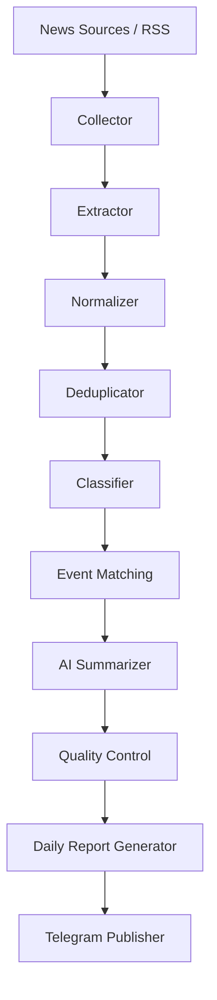

# معماری سیستم (System Architecture)

## ۱. تصمیم‌های معماری مصوب
تصمیم‌های زیر قطعی بوده و بر اساس بند ۳ سند راهنما اتخاذ شده‌اند:

| مؤلفه | فناوری / استاندارد | توجیه و نیازمندی |
|---|---|---|
| **زبان و محیط اجرا** | Python 3.15.2+ | محیط ویندوز فعلی با قابلیت انتقال روان به کانتینر / لینوکس سرور |
| **موتور هوش مصنوعی** | Google Gemini API (`google-genai`) | با لایه واسط انتزاعی (`Provider Pattern`) برای امکان تغییر مدل در آینده |
| **پایگاه داده** | PostgreSQL Native | دیتابیس رابطه‌ای امن برای تراکنش‌ها و روابط چندبه‌چند پیچیده |
| **نگاشت شیء-رابطه (ORM)** | SQLAlchemy 2.0 (Async) | مدیریت ناهمگام مدل‌ها با `asyncpg` |
| **مدیریت ساختار دیتابیس** | Alembic | اعمال هرگونه تغییر مدل منحصراً از طریق Migrationهای کنترل‌شده |
| **زمان‌بندی وظایف** | APScheduler (AsyncIO) | زمان‌بندی دقیق جاب‌های ساعتی و روزانه بدون بلاک کردن Event Loop |
| **کلاینت تلگرام** | aiogram 3.x | ارتباط کاملاً ناهمگام، پایدار و مقاوم با Bot API |
| **دریافت RSS و شبکه** | feedparser + httpx | دریافت پرسرعت با قابلیت Timeout و Retry کنترل‌شده |
| **استخراج محتوا** | Trafilatura (در فاز تکمیل Collector) | استخراج متن اصلی بدنه و زدودن تبلیغات از صفحات وب |
| **اعتبارسنجی داده** | Pydantic v2 & Pydantic-Settings | مدل‌سازی و صحه‌گذاری دقیق ورودی‌ها و خروجی‌های ساخت‌یافته |
| **زبان خروجی و زمان** | فارسی / منطقه زمانی `Asia/Tehran` | استاندارد گزارش‌ها |

---

## ۲. گردش کار خط لوله داده (Data Pipeline)

جریان داده در سیستم به صورت ۱۰ مرحله متوالی طراحی شده است:

### وظایف هر مرحله:
1. **Collector:** دریافت فید RSS و متادیتا، مدیریت سشن‌های شبکه، ثبت خطاهای ارتباطی.
2. **Extractor:** دریافت بدنه اصلی خبر از لینک منبع (با Trafilatura)، استخراج تاریخ، نویسنده و متن خالص، حذف منوها و تبلیغات.
3. **Normalizer:** استانداردسازی URLها (حذف پارامترهای رهگیری مثل utm و fbclid)، نرمال‌سازی تاریخ‌ها به UTC، محاسبه هش محتوا (`content_hash`).
4. **Deduplicator:** جلوگیری از پردازش مجدد URLهای تکراری و متون مشابه از طریق تطبیق دقیق و نزدیک هش محتوا.
5. **Classifier:** غربالگری اولیه جهت سنجش ارتباط خبر با خاورمیانه، تشخیص کشورها، بازیگران و دسته‌بندی موضوعی ده‌گانه.
6. **Event Matching:** تشخیص اینکه آیا مقاله جدید به یک رویداد موجود تعلق دارد یا رویدادی مستقل و جدید است؛ جلوگیری از ایجاد بی‌رویه رکوردهای Event.
7. **AI Summarizer:** فراخوانی مدل زبانی با پرامپت مهندسی‌شده و خروجی Structured JSON جهت استخراج تیتر و خلاصه به زبان فارسی با انتساب ادعاها.
8. **Quality Control:** بررسی ساختار فیلدهای خروجی، تطبیق وضعیت اعتبارسنجی، کنترل عدم وجود گزاره‌های متناقض و توهم مدل.
9. **Daily Report Generator:** فیلتر کردن رویدادهای بازه ۲۴ ساعته بر اساس اولویت و اهمیت، تجمیع رویدادها و قالب‌بندی گزارش روزانه.
10. **Telegram Publisher:** انتشار متن قالب‌بندی‌شده در کانال و ارسال مستقیم به مدیر با رعایت محدودیت‌های کاراکتر تلگرام و ثبت شناسه‌ها.

---

## ۳. لایه انتزاع هوش مصنوعی (AI Abstraction Layer)

مدل هوش مصنوعی نباید در کدهای کاربردی یا خط لوله پردازش به طور مستقیم فراخوانی یا ایمپورت شود. معماری این لایه بر مبنای اصل تفکیک مسئولیت‌ها (Separation of Concerns) به دو لایه «انتقال» و «دامنه تحریریه» تقسیم شده است:

### ۳.۱. لایه انتقال داده و ارتباط با مدل‌ها (`app/ai/provider.py`)
- **اینترفیس پایه (`BaseAIProvider`):** تعریف متد انتزاعی ناهمگام `generate_json(prompt, system_instruction, *, is_preflight)` و پراپرتی `model_name`. این لایه به عنوان یک لایه کمینه‌گرا (Transport Layer) صرفاً وظیفه ارسال پرامپت و دریافت پاسخ معتبر JSON را بر عهده دارد و کاملاً مستقل از منطق تجاری و تحریریه خبر است.
- **ارائه‌دهنده جمنای (`GeminiProvider`):** پیاده‌سازی رسمی با استفاده از `gemini-api-rotator`، مدیریت استخر چندکلیدی در سطح چند پروژه Google Cloud، پایداری وضعیت کلیدهای تعلیق‌شده و آمار درخواست‌ها در PostgreSQL (جداول `gemini_suspended_keys`، `gemini_key_stats`، `gemini_request_log`) و مکانیزم فال‌بک خودکار از مدل اصلی (`gemini-3.8-flash`) به مدل پشتیبان (`gemini-3.5-flash-lite`). سیاست retention: حذف خودکار ردیف‌های `gemini_request_log` قدیمی‌تر از `gemini_log_retention_days` (پیش‌فرض ۳۰ روز) با یک جاب روزانه در ساعت ۰۳:۰۰ تهران. آداپتور `PostgresAdapter` (`app/ai/postgres_adapter.py`) پیاده‌سازی همگام از پروتکل `DBAdapter` با `psycopg3` است که بدون بلاک محسوس event loop اجرا می‌شود.
- **ارائه‌دهنده تستی (`MockAIProvider`):** جهت اجرای آزمون‌های قطعی واحد، آفلاین و خط لوله بدون نیاز به شبکه یا کلید واقعی.

### ۳.۲. لایه دامنه و تحریریه هوش مصنوعی (`app/ai/summarizer.py`)
- تفکیک کامل منطق تحریریه از پروتکل ارتباطی: پرامپت مهندسی‌شده (`EDITORIAL_SYSTEM_PROMPT`)، دیلیمیترهای امنیتی ضد تزریق (`<<<UNTRUSTED_ARTICLE_CONTENT>>>`)، اعتبارسنجی مقید ده‌گانه دسته‌ها و وضعیت‌های راستی‌آزمایی با Pydantic (`NewsAnalysis`)، و خودترمیمی خطا در صورت انحراف اسکیما در تابع `analyze_article` متمرکز شده است.

### ۳.۳. انتقال خوشه‌بندی رویدادها از هوش مصنوعی به موتور قطعی (`EventMatcher`)
- در طراحی اولیه، متد فرضی `cluster_events` برای ارائه‌دهنده در نظر گرفته شده بود. با توجه به سقف سهمیه‌ها (Rate Limits) و ضرورت قطعی بودن (Determinism) و تکرارپذیری، وظیفه خوشه‌بندی رویدادها از LLM منفک شد و در فاز ۵ به موتور الگوریتمی قطعی `EventMatcher` (`app/processors/event_matcher.py`) با استفاده از ماتریس بازتوزیع وزن‌ها و ضریب شباهت جکارد منتقل گردید. این تصمیم مانع از هدررفت روزانه ده‌ها فراخوانی هوش مصنوعی برای مقایسه رویدادها شد.
