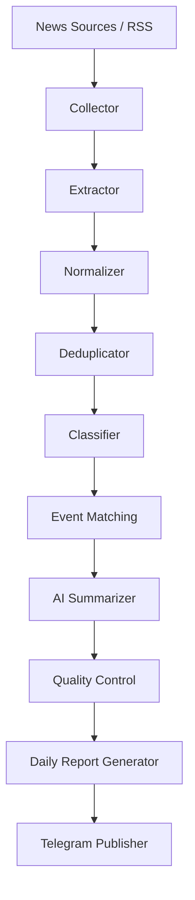

# معماری سیستم (System Architecture)

## ۱. تصمیم‌های معماری مصوب
تصمیم‌های زیر قطعی بوده و بر اساس بند ۳ سند راهنما اتخاذ شده‌اند:

| مؤلفه | فناوری / استاندارد | توجیه و نیازمندی |
|---|---|---|
| **زبان و محیط اجرا** | Python 3.15.2+ | محیط ویندوز فعلی با قابلیت انتقال روان به کانتینر / لینوکس سرور |
| **موتور هوش مصنوعی** | Google Gemini API (`google-genai`) | با لایه واسط انتزاعی (`Provider Pattern`) برای امکان تغییر مدل در آینده |
| **پایگاه داده** | PostgreSQL Native | دیتابیس رابطه‌ای امن برای تراکنش‌ها و روابط چندبه‌چند پیچیده |
| **نگاشت شیء-رابطه (ORM)** | SQLAlchemy 2.0 (Async) | مدیریت ناهمگام مدل‌ها با `asyncpg` |
| **مدیریت ساختار دیتابیس** | Alembic | اعمال هرگونه تغییر مدل منحصراً از طریق Migrationهای کنترل‌شده |
| **زمان‌بندی وظایف** | APScheduler (AsyncIO) | زمان‌بندی دقیق جاب‌های ساعتی و روزانه بدون بلاک کردن Event Loop |
| **کلاینت تلگرام** | aiogram 3.x | ارتباط کاملاً ناهمگام، پایدار و مقاوم با Bot API |
| **دریافت RSS و شبکه** | feedparser + httpx | دریافت پرسرعت با قابلیت Timeout و Retry کنترل‌شده |
| **استخراج محتوا** | Trafilatura (در فاز تکمیل Collector) | استخراج متن اصلی بدنه و زدودن تبلیغات از صفحات وب |
| **اعتبارسنجی داده** | Pydantic v2 & Pydantic-Settings | مدل‌سازی و صحه‌گذاری دقیق ورودی‌ها و خروجی‌های ساخت‌یافته |
| **زبان خروجی و زمان** | فارسی / منطقه زمانی `Asia/Tehran` | استاندارد گزارش‌ها |

---

## ۲. گردش کار خط لوله داده (Data Pipeline)

جریان داده در سیستم به صورت ۱۰ مرحله متوالی طراحی شده است:

### وظایف هر مرحله:
1. **Collector:** دریافت فید RSS و متادیتا، مدیریت سشن‌های شبکه، ثبت خطاهای ارتباطی.
2. **Extractor:** دریافت بدنه اصلی خبر از لینک منبع (با Trafilatura)، استخراج تاریخ، نویسنده و متن خالص، حذف منوها و تبلیغات.
3. **Normalizer:** استانداردسازی URLها (حذف پارامترهای رهگیری مثل utm و fbclid)، نرمال‌سازی تاریخ‌ها به UTC، محاسبه هش محتوا (`content_hash`).
4. **Deduplicator:** جلوگیری از پردازش مجدد URLهای تکراری و متون مشابه از طریق تطبیق دقیق و نزدیک هش محتوا.
5. **Classifier:** غربالگری اولیه جهت سنجش ارتباط خبر با خاورمیانه، تشخیص کشورها، بازیگران و دسته‌بندی موضوعی ده‌گانه.
6. **Event Matching:** تشخیص اینکه آیا مقاله جدید به یک رویداد موجود تعلق دارد یا رویدادی مستقل و جدید است؛ جلوگیری از ایجاد بی‌رویه رکوردهای Event.
7. **AI Summarizer:** فراخوانی مدل زبانی با پرامپت مهندسی‌شده و خروجی Structured JSON جهت استخراج تیتر و خلاصه به زبان فارسی با انتساب ادعاها.
8. **Quality Control:** بررسی ساختار فیلدهای خروجی، تطبیق وضعیت اعتبارسنجی، کنترل عدم وجود گزاره‌های متناقض و توهم مدل.
9. **Daily Report Generator:** فیلتر کردن رویدادهای بازه ۲۴ ساعته بر اساس اولویت و اهمیت، تجمیع رویدادها و قالب‌بندی گزارش روزانه.
10. **Telegram Publisher:** انتشار متن قالب‌بندی‌شده در کانال و ارسال مستقیم به مدیر با رعایت محدودیت‌های کاراکتر تلگرام و ثبت شناسه‌ها.

---

## ۳. لایه انتزاع هوش مصنوعی (AI Abstraction Layer)
مدل هوش مصنوعی نباید در کدهای کاربردی یا پایپ‌لاین به طور مستقیم ایمپورت شود.
- **اینترفیس پایه (`BaseAIProvider`):** تعریف متدهای مشترک (`analyze_news`, `cluster_events`).
- **پیاده‌سازی Gemini (`GeminiProvider`):** مدیریت کلید API، تنظیم مدل، نرخ درخواست، و مدیریت خطا.
- این جداسازی تضمین می‌کند تعویض مدل به نسخه جدیدتر یا ارائه‌دهنده دیگر نیازمند دستکاری در منطق پردازشگر نخواهد بود.
