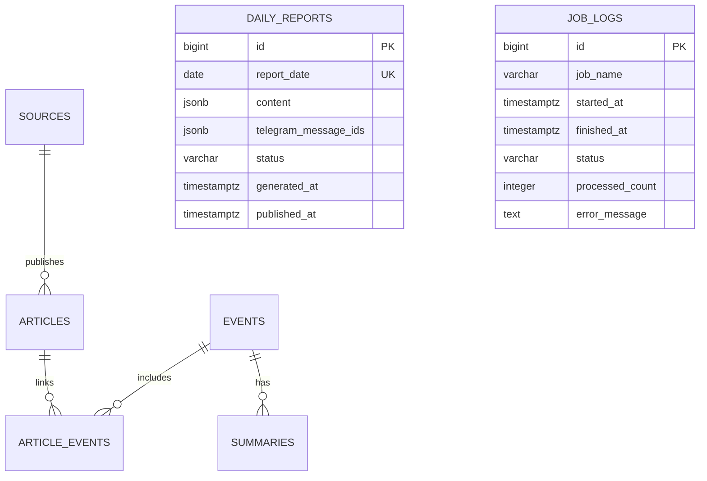

# ساختار و روابط پایگاه داده (Database Schema)

## ۱. پایگاه داده و ابزار مهاجرت
- **سامانه مدیریت پایگاه داده:** PostgreSQL Native
- **درایور ناهمگام:** `asyncpg`
- **ابزار مدیریت اسکیما و مایگریشن:** `Alembic`
- **قانون طلایی:** هیچ جدولی یا ستونی نباید مستقیماً با فراخوانی کدهای پایتون به صورت دستی یا `create_all` در محیط عملیاتی ایجاد شود؛ تمام تغییرات باید به صورت فایل‌های مایگریشن نسخه‌بندی‌شده در شاخه `alembic/versions` نگهداری شوند.

---

## ۲. جداول اصلی سیستم

### شرح جداول و فیلدها:

### ۱. جدول `sources` (منابع خبری)
| فیلد | نوع داده | توضیحات |
|---|---|---|
| `id` | BigInteger (PK) | شناسه یکتا |
| `name` | String(200) (Unique) | نام منبع (مثلاً UN News) |
| `base_url` | Text | آدرس اصلی وب‌سایت منبع |
| `feed_url` | Text | آدرس فید RSS منبع |
| `source_type` | String(40) | نوع منبع (`official`, `regional`, `international`, `wire`) |
| `country` | String(100) | کشور خاستگاه منبع |
| `language` | String(10) | زبان خروجی فید (پیش‌فرض `en`) |
| `is_active` | Boolean | وضعیت فعال بودن برای جمع‌آوری |
| `reliability_note` | Text | یادداشت تحریریه در خصوص سطح اطمینان و سوگیری |
| `created_at` | DateTime(tz) | زمان ثبت منبع در سامانه |

### ۲. جدول `articles` (مقالات دریافت شده)
| فیلد | نوع داده | توضیحات |
|---|---|---|
| `id` | BigInteger (PK) | شناسه یکتا |
| `source_id` | BigInteger (FK -> sources.id) | شناسه منبع |
| `title` | Text | عنوان اصلی خبر |
| `original_url` | Text | پیوند مستقیم به خبر |
| `canonical_url` | Text (Unique) | پیوند استانداردشده (فاقد پارامترهای رهگیری) |
| `original_language`| String(10) | زبان متن دریافت شده |
| `original_text` | Text | متن دریافت شده (خلاصه RSS یا بدنه کامل) |
| `published_at` | DateTime(tz) (Index) | زمان انتشار اعلام‌شده توسط منبع |
| `collected_at` | DateTime(tz) | زمان ثبت و دریافت در ربات |
| `content_hash` | String(64) | مقدار هش SHA-256 نرمال‌شده‌ی عنوان و متن |
| `status` | String(30) | وضعیت پردازش: `collected` (بلافاصله پس از دریافت ست می‌شود؛ `new` صرفاً برای سازگاری اولیه حفظ شده)، `processed`, `summarized`, `rejected`, `failed` |
| `text_source` | String(30) | منبع استخراج متن: `full_body` (متن کامل استخراج‌شده توسط Trafilatura) یا `rss_summary` (خلاصه خام فید) |
| `ai_payload` | JSONB | پاسخ خام ساخت‌یافته دریافتی از مدل هوش مصنوعی |

### ۳. جدول `events` (رویدادهای کلیدی)
| فیلد | نوع داده | توضیحات |
|---|---|---|
| `id` | BigInteger (PK) | شناسه یکتا |
| `title` | Text | عنوان عمومی رویداد |
| `event_type` | String(50) | کد موضوعی اصلی (`POL`, `MIL`, `DIP`, ...) |
| `countries` | JSONB | آرایه‌ای از کشورهای مرتبط با رویداد |
| `actors` | JSONB | اشخاص، سازمان‌ها یا دولت‌های درگیر |
| `location` | Text | مکان جغرافیایی یا شهر محل رخداد |
| `event_started_at`| DateTime(tz) | زمان تخمینی وقوع رویداد |
| `first_seen_at` | DateTime(tz) | اولین زمان مشاهده در اخبار |
| `last_updated_at` | DateTime(tz) | زمان آخرین به‌روزرسانی یا الحاق خبر جدید |
| `importance` | SmallInteger | درجه اهمیت از ۱ (پایین) تا ۵ (فوق‌العاده مهم) |
| `status` | String(30) | وضعیت رویداد (`active`, `resolved`, `archived`) |

### ۴. جدول `article_events` (پیوند چندبه‌چند مقالات و رویدادها)
| فیلد | نوع داده | توضیحات |
|---|---|---|
| `id` | BigInteger (PK) | شناسه یکتا |
| `article_id` | BigInteger (FK -> articles.id) | شناسه مقاله |
| `event_id` | BigInteger (FK -> events.id) | شناسه رویداد |
| `match_type` | String(30) | نوع انطباق (`initial`, `ai_clustered`, `manual`) |
| `confidence` | Numeric(4,3) | ضریب اطمینان انطباق (بین 0.000 تا 1.000) |
| `created_at` | DateTime(tz) | زمان پیوند |
*قیود:* یکتایی زوج (`article_id`, `event_id`) به نام `uq_article_event`.

### ۵. جدول `summaries` (خلاصه‌های تحریریه به زبان فارسی)
| فیلد | نوع داده | توضیحات |
|---|---|---|
| `id` | BigInteger (PK) | شناسه یکتا |
| `event_id` | BigInteger (FK -> events.id) | شناسه رویداد مربوطه |
| `headline_fa` | Text | تیتر خبری دقیق، گویا و بی‌طرف به زبان فارسی |
| `summary_fa` | Text | متن خلاصه فارسی حاوی حقایق ملموس و انتساب ادعاها |
| `details_fa` | JSONB | متادیتای تکمیلی (منابع، پیوندها، آمارها) |
| `verification_status`| String(30) | وضعیت راستی‌آزمایی طبق پروتکل تحریریه |
| `model_name` | String(100) | مدل هوش مصنوعی استفاده‌شده (مانند gemini-2.5-flash) |
| `prompt_version` | String(30) | نسخه پرامپت تولیدکننده خلاصه |
| `created_at` | DateTime(tz) | زمان تولید خلاصه |

### ۶. جدول `daily_reports` (گزارش‌های جامع روزانه)
| فیلد | نوع داده | توضیحات |
|---|---|---|
| `id` | BigInteger (PK) | شناسه یکتا |
| `report_date` | Date (Unique) | تاریخ گزارش مربوط به رویدادهای آن روز |
| `content` | JSONB | ساختار کامل محتوای گزینش‌شده برای انتشار |
| `telegram_message_ids`| JSONB | لیست شناسه‌های پیام‌های ارسالی به تلگرام |
| `status` | String(30) | وضعیت (`draft`, `generated`, `published`, `failed`) |
| `generated_at` | DateTime(tz) | زمان تولید اولیه |
| `published_at` | DateTime(tz) | زمان موفقیت‌آمیز انتشار در تلگرام |

### ۷. جدول `job_logs` (لاگ اجرای فرآیندهای پس‌زمینه)
| فیلد | نوع داده | توضیحات |
|---|---|---|
| `id` | BigInteger (PK) | شناسه یکتا |
| `job_name` | String(100) | نام جاب (`hourly_collection`, `daily_report`) |
| `started_at` | DateTime(tz) | زمان آغاز اجرا |
| `finished_at` | DateTime(tz) | زمان پایان اجرا |
| `status` | String(30) | نتیجه اجرا (`running`, `success`, `failed`, `interrupted`) |
| `processed_count` | Integer | تعداد مقالات پردازش‌شده در این اجرا |
| `error_message` | Text | متن ردیابی خطا در صورت شکست |

---

## ۳. شاخص‌ها و بهینه‌سازی‌های ضروری (Technical Debt شناسایی‌شده)
1. **شاخص روی `content_hash`:** در حال حاضر روی ستون `content_hash` در جدول `articles` شاخص یا قید یکتایی تعریف نشده است که مانع جستجوی سریع در سناریوی حذف تکرار محتوا می‌شود.
2. **شاخص روی `collected_at`:** فیلتر بازه زمانی گزارش روزانه روی `Article.collected_at` اعمال می‌شود اما روی این ستون شاخصی وجود ندارد.
