# سند طراحی فاز ۷: سامانه انتشار مقاوم تلگرام (Telegram Publisher & Resilient Delivery)

**پروژه:** Middle East News Intelligence & Aggregation Bot  
**نسخه:** 1.0  
**تاریخ تصویب:** ۱۰ نوامبر ۲۰۲۶  
**وضعیت:** مصوب و اجرایی  

---

## ۱. اهداف و معماری فاز ۷

هدف فاز ۷ طراحی و پیاده‌سازی سامانه انتشار نهایی بولتن‌های تحلیلی روزانه در پلتفرم پیام‌رسان تلگرام با استفاده از کتابخانه ناهمگام `aiogram 3.x` است. این مؤلفه حلقه نهایی خط لوله خودکار (Pipeline) را تکمیل می‌کند.

```mermaid
flowchart TD
    DR[DailyReport Record in DB] --> Checker{Fail-Closed Check}
    Checker -->|content_quality != 'real' and app_env != 'test'| Refuse[MockPublishRefusedError]
    Checker -->|content_quality == 'real' or app_env == 'test'| Formatter[HTML Chunk Splitter ISS-008]
    Formatter --> DryRunCheck{Is Dry-Run?}
    DryRunCheck -->|Yes| DryLog[Print Preview & Skip Network]
    DryRunCheck -->|No| ChannelSend[Send Chunks to Channel with Tenacity Retry]
    ChannelSend -->|FloodWait 429| BackoffSleep[Sleep retry_after & Retry]
    ChannelSend -->|Network Error| ExpSleep[Exponential Backoff & Retry]
    ChannelSend -->|Permanent Error| FailState[Save Partial Message IDs & Set status='failed']
    ChannelSend -->|All Chunks Sent| AdminSend[Send Operational Summary to Admin]
    AdminSend --> DBUpdate[Set status='published' & Save telegram_message_ids]
```

---

## ۲. تصمیم بنیادین پیرامون فرمت گزارش و `parse_mode` (رفع ابهام ۱)

### ۲.۱. گزینه‌های پیش‌رو
1. **Option A: `parse_mode=None` (متن ساده یونیکد):**
   - گزارش به صورت متن خام با کاراکترهای یونیکد و ایموجی منتشر می‌شود.
   - تگ‌های HTML وجود نخواهند داشت؛ بنابراین تصحیح ISS-008 صرفاً کدنویسی دفاعی (پیشگیرانه) باقی می‌ماند.
2. **Option B: `parse_mode="HTML"` (قالب‌بندی غنی HTML):**
   - تیترها با تگ‌های `<b>...</b>` برجسته می‌شوند.
   - منابع خبری به جای URLهای طولانی و ناخوانا، به صورت پیوندهای هایپرلینک تعاملی `<a href="...">نام منبع</a>` نمایش می‌یابند.
   - تاریخ‌ها با تگ‌های `<code>...</code>` نشان داده می‌شوند.
   - تصحیح ISS-008 (Tag-Aware Stack Splitter) به صورت **فعال، حیاتی و الزامی** در تقطیع چانک‌ها وارد عمل می‌شود.
3. **Option C: `parse_mode="MarkdownV2"`:**
   - نیازمند Escape کردن حدود ۲۰ کاراکتر خاص است و شکنندگی بالایی در متون فارسی و اخبار چندمنبعی دارد.

### ۲.۲. تصمیم نهایی (Decision)
**گزینه مصوب: Option B (`parse_mode="HTML"`)**
- تیترهای تحلیلی و دسته‌بندی‌ها به شکل بولد (`<b>`) عرضه می‌شوند.
- منابع اصلی و تکمیلی با پیوند تمیز (`<a href="...">`) فرمت می‌شوند.
- تابع `format_persian_daily_report` در `app/reports/daily_report.py` مجهز به تگ‌های متوازن HTML گردید.
- الگوریتم تقطیع ISS-008 در مرز هر چانک، تگ‌های باز را به صورت خودکار می‌بندد و در چانک بعدی بازگشایی می‌کند تا خطای Parse Mode تلگرام به صفر مطلق برسد.

---

## ۳. سیاست امنیتی امتناع در وضعیت خطا (Fail-Closed Security Policy)

طبق منشور خط‌مشی تحریریه و انضباط امنیت محتوا:
1. **قاعده امتناع:** هرگونه گزارشی که وضعیت کیفیت محتوای آن (`content_quality`) برابر با `'real'` نباشد (مانند `'mock'`، `'mixed'`، `None` یا داده‌های شبیه‌سازی‌شده)، در محیط‌های غیرتستی (`app_env != "test"`) به طور قطعی با خطای `MockPublishRefusedError` متوقف می‌شود.
2. **عدم وجود پارامتر دورزدن:** هیچ پارامتر ورودی برای غیرفعال‌سازی این بررسی امنیتی وجود ندارد.
3. **تفکیک تست و پروداکشن:** تنها در محیط `app_env == "test"` اجازه ارسال داده‌های شبیه‌سازی برای تست‌های یکپارچگی aiogram داده می‌شود.

---

## ۴. تحویل دوگانه به مقاصد (Dual Destination Delivery)

سامانه دو مقصد مشخص دارد:
1. **کانال عمومی تلگرام (`settings.telegram_channel_id`):**
   - دریافت‌کننده چانک‌های اصلی بولتن (Chunk 1, Chunk 2, Chunk 3, ...).
   - برای هر چانک پیش‌نمایش لینک وب غیرفعال است (`disable_web_page_preview=True`).
2. **چت مدیر سیستم (`settings.telegram_admin_chat_id`):**
   - دریافت‌کننده یک پیام خلاصه عملیاتی و تله‌متری (Operational Summary) شامل:
     - تاریخ گزارش
     - تعداد چانک‌های منتشرشده در کانال
     - وضعیت کیفیت محتوا (`content_quality`)
     - لیست شناسه‌های پیام تلگرام تولیدشده در کانال جهت پایش و پیگیری.

---

## ۵. تاب‌آوری در تحویل و ماشین وضعیت (Resilient Delivery & State Machine)

### ۵.۱. خط‌مشی‌های بازتلاش (Retry Policies via Tenacity / Resilience Loop)
- **خطای محدودیت تلگرام (`TelegramRetryAfter` / FloodWait 429):**
  - زمان خواب دقیق اعلام‌شده توسط سرور تلگرام (`e.retry_after`) رعایت شده و فرآیند تا ۳ بار بازتلاش می‌شود.
- **خطای شبکه (`TelegramNetworkError` / Connection Glitch / Timeout):**
  - با الگوریتم عقب‌نشینی نمایی (Exponential Backoff: $1\text{s}, 2\text{s}, 4\text{s}$) تا ۳ بار بازتلاش انجام می‌گیرد.
- **خطاهای دائمی تلگرام (`TelegramAPIError` مانند 400 یا 403):**
  - بلافاصله گزارش شده و بدون هدر دادن سهمیه بازتلاش متوقف می‌شود.

### ۵.۲. ثبت پیشرفت جزئی (Partial Delivery Tracking)
اگر در حین ارسال چانک ۲ خطای غیرقابل جبرانی رخ دهد:
- شناسه‌های چانک‌هایی که قبلاً با موفقیت ارسال شده‌اند (`telegram_message_ids`) در دیتابیس ذخیره می‌مانند.
- وضعیت گزارش در جدول `daily_reports` به `'failed'` تغییر می‌یابد.
- این امر مانع از ارسال مجدد چانک‌های قبلی یا گم‌شدن رکوردهای ارسال‌شده در کانال می‌شود.

### ۵.۳. جدول ماشین وضعیت گزارش (`daily_reports.status`)

| وضعیت پیشین | رویداد / شرط | وضعیت پسین | اقدامات جانبی |
|:---:|:---:|:---:|:---|
| `generated` | فراخوانی publish در وضعیت `mock` (non-test) | `generated` | پرتاب `MockPublishRefusedError` (بدون تغییر در DB) |
| `generated` | آغاز انتشار واقعی | `publishing` | قفل رکورد |
| `publishing` | ارسال موفق همه چانک‌ها و پیام مدیر | `published` | ذخیره `telegram_message_ids` و `published_at` |
| `publishing` | خطای پایدار در چانک $k$ | `failed` | ذخیره شناسه‌های چانک‌های $1$ تا $k-1$ در `telegram_message_ids` |
| `failed` | بازپردازش و انتشار مجدد موفق | `published` | به‌روزرسانی شناسه‌ها و `published_at` |

---

## ۶. حالت شبیه‌سازی انتشار (Dry-Run Mode)

برای اطمینان کامل اپراتور قبل از هرگونه فراخوانی شبکه:
- با آرگومان `--dry-run` یا متغیر `dry_run=True`:
  - گزارش از پایگاه داده بارگذاری و تقطیع می‌شود.
  - مشخصات کامل چانک‌ها، تعداد کاراکترها و توازن تگ‌ها چاپ می‌شود.
  - پیام پیش‌نمایش چت مدیر نمایش داده می‌شود.
  - هیچ درخواستی به API تلگرام ارسال نمی‌شود و تغییری در دیتابیس ایجاد نمی‌گردد.
