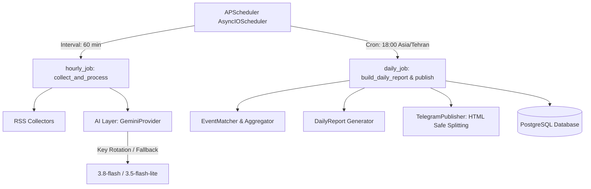

# سند معماری و طراحی فاز ۸: زمان‌بندی، تاب‌آوری و وظایف خودکار (Phase 8 Design Document)

این سند مشخصات فنی، مرزهای ایزولاسیون خطا (Error Boundaries)، آزمون‌های قرارداد میان لایه هوش مصنوعی و زمان‌بند، و پروتکل پایش پایداری مدل‌های هوش مصنوعی را برای فاز ۸ (Scheduler & Production Automation) تبیین می‌کند.

---

## ۱. اهداف و معماری زمان‌بند (APScheduler)

در فاز ۸، ربات از اجرای دستی دستورات به یک سیستم تمام‌خودکار، پایدار و تاب‌آور در برابر قطعی تبدیل می‌شود:
1. **وظیفه ساعتی (`hourly_job`):** جمع‌آوری خوراک‌های RSS، پالایش و حذف موارد تکراری، استخراج موجودیت‌ها و دسته‌بندی با مدل هوش مصنوعی (`collect_and_process`).
2. **وظیفه روزانه (`daily_job`):** تولید گزارش تحلیلی ۲۴ ساعته بر اساس پنجره زمانی ساعت ۱۸:۰۰ به وقت محلی تهران، اعمال ضوابط تحریریه، ایجاد قالب تلگرامی متوازن، و انتشار امن به کانال تلگرام (`build_daily_report` + `publish_report`).



---

## ۲. پایش نرخ خطای ۵۰۳ مدل ۳.۸ و ماتریس تصمیم‌گیری ۷ روزه (3.8-flash 503 Rate Monitoring)

با توجه به مشاهده خطای گذرای ۵۰۳ (`UNAVAILABLE: high demand spike`) در مدل `gemini-3.8-flash` طی آزمون‌های فاز ۷.۵، سیستم پایش نرخ موفقیت مدل در روزهای اول استقرار به شرح زیر فعال می‌گردد:

### ۲.۱. فرمول و شاخص‌های پایش (Telemetry Metrics)
- **شاخص کلیدی پایداری (Availability Metric):**
  $$\text{Success Rate} = \frac{\text{Successful Calls (200 OK)}}{\text{Total Attempted Calls (200 OK + 503 + Transient)}} \times 100\%$$
- **نحوه ثبت و ردیابی:** ثبت هر تلاش ناموفق مدل اولیه در لاگ‌های ساختاریافته سیستم (`logger.warning`) به همراه زمان وقوع و زمان تاخیر Fallback.

### ۲.۲. ماتریس ارزیابی و تصمیم‌گیری در پایان روز هفتم (Day 7 Decision Matrix)

| نرخ موفقیت ۷ روزه (`gemini-3.8-flash`) | تصمیم معماری (Architectural Action) | مدل اصلی (Primary) | مدل پشتیبان (Fallback) | منطق و توجیه فنی |
|:---:|:---:|:---:|:---:|---|
| **بیش از ۹۰٪** ($\ge 90\%$) | **تثبیت وضعیت فعلی** | `gemini-3.8-flash` | `gemini-3.5-flash-lite` | کیفیت تحلیل استدلالی ۳.۸ حفظ شده و نرخ وقوع خطای ۵۰۳ در حد نوسانات گذرای طبیعی اینترنت است. |
| **بین ۷۰٪ تا ۹۰٪** ($70\% - 90\%$) | **معکوس‌سازی اولویت** | `gemini-3.5-flash-lite` | `gemini-3.8-flash` | مدل سبک ۳.۵ به دلیل سرعت بالا و پایداری کامل به بار اصلی تبدیل می‌شود و مدل ۳.۸ برای تحلیل‌های عمیق‌تر باقی می‌ماند. |
| **کمتر از ۷۰٪** ($< 70\%$) | **تنزل به مدل پایدار قدیمی** | `gemini-2.5-flash` | `gemini-3.5-flash-lite` | مدل ۳.۸ به علت ناپایداری مکرر زیرساخت موقتاً از چرخه تولید خارج شده و مدل باثبات ۲.۵ جایگزین می‌گردد. |

---

## ۳. آزمون‌های قرارداد میان زمان‌بند و لایه هوش مصنوعی (Contract Tests for Scheduler)

زمان‌بند نباید در اثر خطاهای لایه هوش مصنوعی کرش کند یا فرایندهای بعدی را مسدود سازد. چهار آزمون قرارداد (Contract Tests) در فایل `tests/test_scheduler_contracts.py` پیاده‌سازی و اعتبارسنجی می‌شوند:

### ۳.۱. سناریو ۱: مسیر موفق (Happy Path)
- **شبیه‌سازی:** مدل اولیه با موفقیت پاسخ معتبر بازمی‌گرداند (یا پس از خطای مجاز، مدل Fallback موفق می‌شود).
- **انتظار قرارداد:** مقالات پردازش شده و به وضعیت `summarized` می‌روند؛ شناسه پیام‌های تلگرام در جدول `daily_reports` ثبت شده و وضعیت گزارش به `published` تغییر می‌یابد. زمان‌بند بدون هیچ خطایی به تیک بعدی منتقل می‌شود.

### ۳.۲. سناریو ۲: اتمام کامل سهمیه (`failed_quota`)
- **شبیه‌سازی:** تمام کلیدها و هر دو مدل اولیه و ثانویه با خطای سهمیه (HTTP 429 / `AIRateLimitError`) مواجه می‌شوند.
- **انتظار قرارداد:** خطا توسط پایپ‌لاین گیر افتاده، لاگ هشدار سطح بحرانی ثبت می‌شود، مقالات پردازش‌نشده در وضعیت `pending` برای ساعت بعد باقی می‌مانند، زمان‌بند کرش نمی‌کند و وظایف دیگر متوقف نمی‌شوند.

### ۳.۳. سناریو ۳: عدم دردسترس‌بودن سرور هوش مصنوعی (`failed_unavailable`)
- **شبیه‌سازی:** هر دو مدل با خطای گذرا یا سرور در دسترس نبودن (HTTP 503 / `AIServiceUnavailableError`) پاسخ می‌دهند.
- **انتظار قرارداد:** زمان‌بند اجرا را متوقف کرده و خطای موقت را ثبت می‌کند بدون اینکه تیک بعدی زمان‌بندی را از دست بدهد؛ پایگاه داده بدون داده‌های فاسد یا ناقص دست‌نخورده باقی می‌ماند.

### ۳.۴. سناریو ۴: خطای غیرقابل جبران محتوا یا داده نامعتبر (`failed_ai`)
- **شبیه‌سازی:** هوش مصنوعی پاسخ JSON ناقص، فاقد کلیدهای الزامی، یا خطای عمومی `AIProviderError` بازمی‌گرداند.
- **انتظار قرارداد:** سیستم آن مقاله خاص را به وضعیت `failed` یا `flagged` انتقال می‌دهد، اما حلقه پردازش سایر مقالات را قطع نمی‌کند و گزارش روزانه می‌تواند با سایر مقالات سالم تولید شود.

---

## ۴. بررسی وضعیت اولیه پیش از اجرا (Pre-flight check) قبل از هر چرخه ساعتی

قبل از هر اجرای `hourly_collection`، یک call سریع و سبک به `gemini-3.8-flash` با prompt ساده (`Respond with {"ok": true}`) ارسال می‌شود:
- **اگر پاسخ معتبر بازگشت (`OK`):** پایپ‌لاین جمع‌آوری و پردازش با مدل اصلی (`3.8-flash`) آغاز می‌گردد.
- **اگر خطای ۵۰۳ یا عدم دسترسی بازگشت (`503 UNAVAILABLE` / `429`):** اجرای این تیک ساعتی skip می‌شود، در جدول `job_logs` با وضعیت `skipped_primary_unavailable` ثبت می‌گردد، و تلاش بعدی به ساعت بعد موکول می‌شود.

- **هزینه:** ۱ فراخوانی سبک در هر ساعت (در صورت سلامت مدل ۳.۸)
- **سود راهبردی:** جلوگیری از پردازش دسته‌جمعی ۳۰ مقاله با مدل Fallback کیفیت پایین‌تر و حفظ خط‌مشی اولویت کیفیت تحلیلی.

---

## ۵. چرخه حیات، مصالحه آغازین پروسس و مدیریت نشست‌ها (Startup Reconciliation & Session Management)

### ۵.۱. مصالحه پروسس‌های ناتمام در آغاز به کار (`reconcile_interrupted_jobs`):
اگر در اثر ری‌استارت سرور یا اختلال موقت، وظیفه‌ای در وضعیت `running` باقی مانده باشد، در هنگام استارت‌آپ سیستم:
```sql
UPDATE job_logs 
SET status = 'interrupted', finished_at = NOW() 
WHERE status = 'running' AND started_at < NOW() - INTERVAL '30 minutes';
```
پروسس‌های مسدود به صورت خودکار آزاد شده و مانع از اجرای مجدد چرخه‌ها نمی‌شوند.

### ۵.۲. مدیریت نشست‌های پایگاه داده:
در `app/scheduler/jobs.py`، تمام نشست‌های دیتابیس به‌صورت context manager مستقل (`async with SessionLocal() as session:`) اداره می‌شوند تا نشت اتصال (Connection Leak) در طول اجرای طولانی‌مدت پروسس رخ ندهد.

