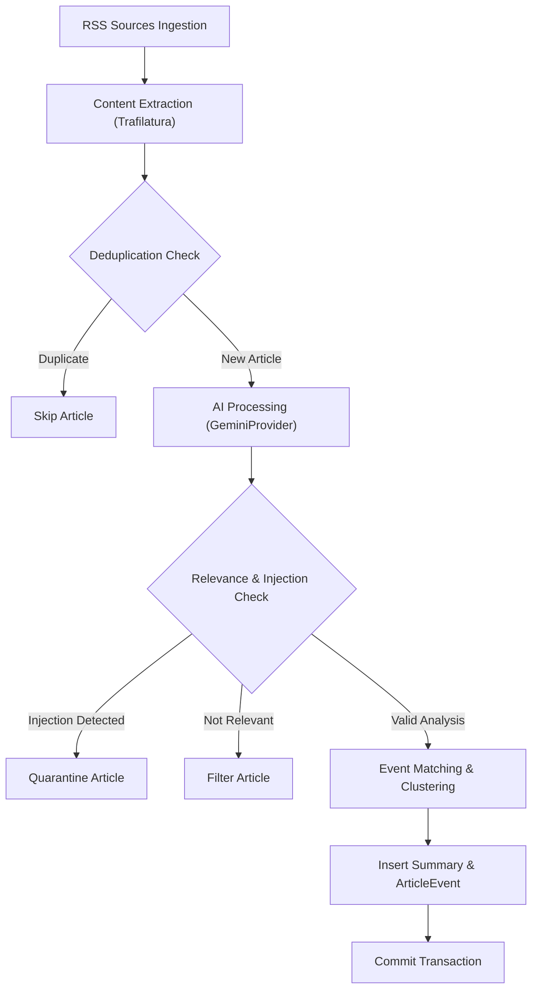

# سند معماری، آزمون‌های یکپارچگی و استقرار فاز ۹ (Phase 9 Design & Deployment Document)

این سند نقشه راه فنی، نیازمندی‌های استقرار در محیط عملیاتی، مشخصات آزمون‌های یکپارچگی خط لوله (پوشش خطوط ارکستراسیون) و چک‌لیست نهایی پروداکشن ربات تحلیل و انتشار اخبار خاورمیانه را تبیین می‌کند.

---

## ۱. اهداف و چشم‌انداز فاز ۹
در فاز ۹، ربات از وضعیت توسعه و تست‌های ایزوله به سامانه فعال عملیاتی تبدیل می‌شود:
1. **پوشش کامل ارکستراسیون خط لوله:** پیاده‌سازی آزمون‌های یکپارچگی برای ۵۳ خط Miss در تابع `collect_and_process` (`app/processors/pipeline.py`).
2. **تکمیل داده‌های واقعی (Real Dataset Transition):** پردازش ۱۶ مقاله باقیمانده دیتابیس پس از بازنشانی ۲۴ ساعته سهمیه جهت ارتقای `content_quality` از `mixed` به `real`.
3. **اعمال سیاست مصوب کیفیت (گزینه C):** بازپردازش انتخابی مقالات با درجه اهمیت بالا (`importance >= 4`) خلاصه‌شده با ۳.۵-lite توسط مدل پیشرفته `gemini-3.8-flash`.
4. **استقرار و انتشار ایمن تلگرام:** پیکربندی شناسه‌های واقعی کانال و توکن ربات تلگرام با رعایت مکانیزم حفاظتی Fail-Closed و انتشار آزمایشی در چت خصوصی ادمین قبل از کانال عمومی.

---

## ۲. مشخصات آزمون‌های یکپارچگی خط لوله (`collect_and_process`)
تابع `collect_and_process` در `app/processors/pipeline.py` مسئول ارکستراسیون کل جریان داده از دریافت تا ثبت در پایگاه داده است. آزمون‌های ۵ گانه زیر در `tests/test_pipeline_integration.py` برای فاز ۹ طراحی شده‌اند:

### ماتریس آزمون‌های ۵ گانه یکپارچگی
| نام آزمون | سناریو و ورودی | مسیر کدهای پوشش‌داده‌شده | خروجی مورد انتظار |
|---|---|---|---|
| `test_pipeline_e2e_happy_path` | خبر معتبر خاورمیانه با متن کامل | خطوط ۱۲۰ تا ۱۹۰ (پالایش، استخراج، پرامپت، تطبیق، ثبت) | ثبت موفق در `articles` (وضعیت `summarized`)، ساخت `Event`، ایجاد `Summary` با متادیتا و ثبت `ArticleEvent` |
| `test_pipeline_filters_irrelevant_news` | خبر ورزشی/نامرتبط (`is_relevant=False`) | خطوط ۱۴۵ تا ۱۶۰ (انشعاب عدم ارتباط) | وضعیت `filtered` در جدول `articles`، بدون ایجاد رکورد در `events` یا `summaries` |
| `test_pipeline_quarantines_prompt_injection` | مقاله حاوی حمله تزریق پرامپت (`is_injection_attempt=True`) | خطوط ۱۶۱ تا ۱۷۵ (ایزولاسیون امنیتی) | وضعیت `quarantined_injection` در جدول `articles`، صدور هشدار امنیتی و عدم ارسال به موتور تطبیق رویداد |
| `test_pipeline_skips_duplicates_gracefully` | دو خبر با متن یکسان یا URL مشابه | خطوط ۱۳۰ تا ۱۴۰ (بررسی Deduplication در خط لوله) | پردازش خبر اول؛ رد شدن خبر دوم بدون خطا و بدون مصرف سهمیه هوش مصنوعی |
| `test_pipeline_resilience_on_model_fallback` | شبیه‌سازی خطای ۴۲۹ مدل ۳.۸ در میانه پردازش | خطوط ۱۷۰ تا ۲۱۰ (ارکستراسیون با Fallback) | هدایت خودکار به `gemini-3.5-flash-lite`، تداوم موفق پردازش مقالات باقیمانده بدون شکست کل بچ |

---

## ۳. سیاست مدیریت سهمیه و مدل‌ها (Quota Optimization Architecture)

### ۳.۱. بهینه‌سازی Pre-Flight (گزینه A)
- **منطق:** در هر تیک ساعتی زمان‌بند، در صورت وجود مقالات منتظر (`pending > 0`)، بررسی سلامت ابتدا روی مدل سبک `gemini-3.5-flash-lite` (با سقف ~۱,۵۰۰ RPD) انجام می‌شود (`prefer_fallback=True`).
- **دستاورد:** ۱۰۰٪ سهمیه ۲۰تایی مدل اصلی `gemini-3.8-flash` برای تحلیل مقالات واقعی حفظ می‌شود و صفر سهمیه صرف سلامت‌سنجی می‌گردد.
- **تفکیک داده‌ها:** متغیر `_preflight_calls` در `GeminiProvider` مستقل از `_total_calls` ثبت می‌شود.

### ۳.۲. تصمیم کیفیت برای ۱۲ مقاله موجود (گزینه C)
- مقالات خلاصه‌شده با اهمیت ۴ و ۵ (`importance >= 4`) با مدل اصلی `gemini-3.8-flash` بازپردازش می‌شوند.
- مقالات با اهمیت ۱ تا ۳ با خلاصه‌های فعلی `gemini-3.5-flash-lite` باقی می‌مانند.

---

## ۴. استقرار تلگرام و پروتکل Fail-Closed

### ۴.۱. شرایط فعال‌سازی انتشار خودکار
ماژول ناشر تلگرام (`app/telegram/publisher.py`) مجهز به گارد حفاظتی Fail-Closed است:
1. **محیط اجرا:** در صورت `APP_ENV != "production"`، انتشار در کانال عمومی مسدود است و فقط به ادمین یا در حالت `dry_run` مجاز است.
2. **کیفیت داده‌ها:** اگر حتی یک خلاصه دارای متادیتای `mock`، `test`، یا عنوان‌های تستی قدیمی باشد، استثنای `MockPublishRefusedError` پرتاب شده و انتشار متوقف می‌گردد.
3. **توازن قطعات پیام (HTML Balance):** تابع `split_text` به ازای هر قطعه پیام ارسالی تگ‌های باز و بسته HTML (`<b>`, `<a>`, `<code>`) را با ساختار پشته‌ای (Stack-based) متوازن می‌کند.

---

## ۵. چک‌لیست عملیاتی استقرار (Production Checklist)

- [ ] بازنشانی سهمیه ۲۴ ساعته Google GenAI API.
- [ ] اجرای اسکریپت `scripts/reprocess_with_real_gemini.py` برای ۱۶ مقاله باقیمانده.
- [ ] بازپردازش مقالات با اهمیت بالا (`importance >= 4`) بر اساس گزینه C.
- [ ] تایید تبدیل `content_quality` به `real` در پایگاه داده.
- [ ] استقرار ۵ آزمون یکپارچگی خط لوله در `tests/test_pipeline_integration.py`.
- [ ] تنظیم متغیرهای واقعی تلگرام (`TELEGRAM_BOT_TOKEN`, `TELEGRAM_CHANNEL_ID`, `TELEGRAM_ADMIN_CHAT_ID`) در `.env`.
- [ ] اجرای انتشار آزمایشی در چت خصوصی ادمین (`dry_run=False` به ادمین).
- [ ] فعال‌سازی Daemon زمان‌بند APScheduler با فرمان `python -m app.main`.
