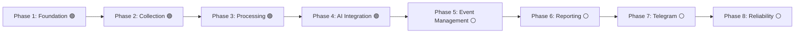

# نقشه راه توسعه (Development Roadmap)

این سند مراحل پیاده‌سازی و معیارهای پذیرش (Acceptance Criteria) هر فاز را طبق بندهای ۱۲ و ۱۳ سند راهنمای پروژه مشخص می‌کند.

---

## بررسی اجمالی فازها

---

## شرح تفصیلی فازها و معیارهای پذیرش

### فاز ۱ — زیرساخت و پایه‌ها (Phase 1 — Project Foundation) 🟢 [تکمیل‌شده]
- **اهداف:**
  - ساماندهی وابستگی‌ها در `requirements.txt` و `requirements-dev.txt` (افزودن Alembic، greenlet، pytest، pytest-asyncio).
  - راه‌اندازی ساختار رسمی مهاجرت دیتابیس با Alembic و نخستین ریویژن اسکیما.
  - اصلاح لودینگ تنظیمات در `app/config.py` جهت پشتیبانی از تست‌ها بدون الزام به وجود فایل تولیدی `.env`.
  - استقرار چارچوب آزمون (Testing Framework) با ۱۶ تست واحد اولیه.
- **معیار پذیرش (محقق‌شده):**
  - دستور `alembic upgrade head --sql` جداول و ایندکس‌ها را با موفقیت تولید می‌کند.
  - ایمپورت تمامی ماژول‌های پروژه بدون خطای سینتکس یا خطای عدم متغیرهای محیطی انجام می‌شود.
  - تمامی ۱۶ تست با موفقیت اجرا شده و ۱۰۰٪ سبز هستند (پوشش ۴۰٪ کل پروژه).

---

### فاز ۲ — دریافت و ثبت اخبار (Phase 2 — News Collection) 🟢 [تکمیل‌شده]
- **اهداف محقق‌شده:**
  - ارتقای کلاینت RSS در `app/collectors/rss_collector.py` با مکانیزم Retry نمایی (با کتابخانه `tenacity`، تا ۳ تلاش مجدد برای خطاهای گذرا و کدهای وضعیت 429/5xx).
  - مدیریت دقیق زمان خاتمه (Timeout) با تفکیک `connect=5.0s` و `total=20.0s`.
  - استانداردسازی هدرها (`User-Agent` رسمی، `Accept` اختصاصی انواع فیدهای XML و صفحات وب، `Accept-Encoding`).
  - تفکیک و ایزوله‌سازی خطاهای هر فید با کلاس‌های خطای سفارشی (`FeedFetchError`، `CollectorError`) بدون اثر منفی بر سایر فیدها.
  - ادغام ماژول استخراج متن بدنه با کتابخانه `Trafilatura` (`extract_full_text_from_html` و `fetch_article_full_text`) جهت زدودن نویز و استخراج متون کامل.
  - توسعه تست‌های جامع شبکه‌ای (Mock httpx) برای بررسی حالت‌های 200 OK، خطای 500، Timeout، عدم تلاش مجدد روی خطای 404، فیدهای XML معیوب و استخراج Trafilatura (مجموع ۱۷ تست واحد در ماژول collectors).
  - اجرای جمع‌آوری زنده (Live End-to-End Test) از فید رسمی UN News و ذخیره‌سازی موفقیت‌آمیز ۳۰ خبر در جدول `articles` پایگاه داده واقعی PostgreSQL با اعتبارسنجی مجزا توسط psql.
- **معیار پذیرش (محقق‌شده):**
  - دریافت موفقیت‌آمیز فیدها با شبیه‌سازی شبکه‌ای (Mock httpx) و ذخیره داده‌ها در تست‌های مجزا.
  - ذخیره واقعی اخبار فید زنده سازمان ملل در جدول `articles` دیتابیس PostgreSQL و تأیید کوئری‌های SQL.

---

### فاز ۳ — پالایش، نرمال‌سازی و تکرارزدایی (Phase 3 — Processing) 🟢 [تکمیل‌شده]
- **اهداف محقق‌شده:**
  - رفع کامل نقص بدهی فنی `ISS-004 Part B` با بازنویسی کوئری تکرارزدایی در `app/processors/pipeline.py` از طریق تابع اختصاصی `is_duplicate_article`.
  - اعمال شرط هم‌ارزی منطقی `or_(Article.canonical_url == canonical_url, Article.content_hash == content_hash)`.
  - اجرای آزمون‌های اختصاصی در `tests/test_pipeline.py` برای سناریوی A (ردگیری و حذف پارامترهای رهگیری) و سناریوی B (تشخیص بازنشر متن یکسان با URL متفاوت).
  - آزمون طرح اجرایی SQL با `EXPLAIN ANALYZE` و اثبات بهره‌گیری دیتابیس از شاخص‌های `ix_articles_content_hash` و `uq_articles_canonical_url` به صورت `BitmapOr` و `Index Scan`.
  - آزمون زنده در محیط واقعی دیتابیس با اسکریپت `scripts/test_phase3_dedup_live.py` و اثبات رد اخبار تکراری در هر دو سناریو.
- **معیار پذیرش (محقق‌شده):**
  - خروجی ۳۳ آزمون سبز با pytest و خروجی موفقیت‌آمیز اسکریپت آزمون زنده در سناریوهای A و B و C.

---

### فاز ۴ — ادغام هوش مصنوعی و خلاصه‌سازی (Phase 4 — AI Integration) 🟢 [تکمیل‌شده]
- **اهداف محقق‌شده:**
  - استقرار معماری انتزاعی `BaseAIProvider` طبق سند معماری با متد ناهمگام `generate_json` و پیاده‌سازی ارائه‌دهنده‌های `GeminiProvider` و `MockAIProvider`.
  - اعمال مکانیزم‌های تاب‌آوری: پایش سقف درخواست در دقیقه (Sliding Window Rate Limiter)، کنترل همروندی با سمافور، زمان خاتمه و تلاش مجدد نمایی با Tenacity برای خطاهای گذرای ۴۲۹ و ۵۰۳.
  - مهندسی پرامپت با سازوکار دفاع در برابر تزریق پرامپت (Prompt Injection Defense): جداسازی ورودی‌ها با بلاک‌های صریح `<<<UNTRUSTED_ARTICLE_CONTENT>>>`، پاک‌سازی کاراکترهای نشانه‌گذار و دستورالعمل‌های بازدارنده جهت جلوگیری از نفوذ و برچسب‌گذاری فیلد `is_injection_attempt`.
  - اعتبارسنجی مقید و سخت‌گیرانه با Pydantic (کدهای ۱۰گانه دسته‌بندی و ۵ وضعیت رسمی راستی‌آزمایی طبق `EDITORIAL_POLICY.md`).
  - ثبت خودکار شناسه‌های `model_name` و `prompt_version` در جدول پایگاه داده `summaries`.
  - نگارش ۱۰ تست جامع در `tests/test_ai.py` (شبیه‌سازی Mock، سنجش نفوذ پرامپت، خطاهای اعتبارسنجی مقید و محدودیت ریت).
  - اجرای تست سرتاسری (End-to-End) روی خبر واقعی با متن کامل از دیتابیس و ثبت رکورد در جداول `events` و `summaries` و تأیید کوئری‌های SQL.
- **معیار پذیرش (محقق‌شده):**
  - تمامی تست‌های ماژول هوش مصنوعی با موفقیت پاس شدند (۴۴ تست سبز در کل پروژه).
  - ثبت رکورد واقعی در جدول `summaries` با `model_name='gemini-2.5-flash'` و `prompt_version='v2'`.

---

### فاز ۵ — مدیریت و انطباق رویدادها (Phase 5 — Event Management) ⚪ [گام بعدی]
- **اهداف:**
  - پیاده‌سازی موتور تطبیق رویدادها (`Event Matching`): خوشه‌بندی مقالات جدید با رویدادهای ۲۴ تا ۴۸ ساعت اخیر.
  - بررسی اشتراک مکان، بازیگران، کلمات کلیدی و تشابه برداری/متنی.
  - انتساب چند مقاله به یک رکورد `Event` در جدول `article_events`.
- **معیار پذیرش:**
  - چند مقاله از خبرگزاری‌های مختلف در مورد یک رویداد خاص به یک رکورد رویداد مشترک متصل شوند.

---

### فاز ۶ — تدوین گزارش جامع روزانه (Phase 6 — Reporting) ⚪ [آتی]
- **اهداف:**
  - فیلتر کردن رویدادهای ۲۴ ساعت گذشته بر اساس درجه اهمیت (`importance >= min_importance`).
  - جلوگیری از نمایش چندباره یک رویداد در گزارش.
  - قالب‌بندی متنی زیبا، خوانا و تفکیک‌شده به زبان فارسی طبق استاندارد تحریریه.
  - ذخیره نسخه نهایی گزارش در جدول `daily_reports` با وضعیت `generated`.
- **معیار پذیرش:**
  - گزارش حاوی تیترها، خلاصه‌ها، منابع، وضعیت راستی‌آزمایی و لینک‌های معتبر بدون شکستگی فرمت باشد.

---

### فاز ۷ — انتشار در تلگرام و مدیریت خطا (Phase 7 — Telegram Publisher) ⚪ [آتی]
- **اهداف:**
  - ارسال گزارش به کانال رسمی تلگرام و ارسال موازی به چت خصوصی ادمین.
  - قطعه‌بندی هوشمند متن‌های طولانی به پیام‌های کمتر از ۴۰۰۰ کاراکتر با بستن تگ‌های ناقص HTML.
  - مدیریت خطاهای تلگرام (FloodWait، اتصال ضعیف) با Retry.
  - به‌روزرسانی رکوردهای `daily_reports` و ثبت شناسه‌های پیام (`telegram_message_ids`).
- **معیار پذیرش:**
  - گزارش با موفقیت در کانال و چت ادمین ارسال و وضعیت رکورد به `published` تغییر یابد.

---

### فاز ۸ — پایداری، آزمون فراگیر و بهینه‌سازی (Phase 8 — Reliability) ⚪ [آتی]
- **اهداف:**
  - پوشش تست واحد و یکپارچگی برای تمامی ماژول‌ها با Mockهای استاندارد.
  - اعتبارسنجی لاگ‌ها در جدول `job_logs` و چرخش لاگ‌های سیستمی.
  - تست پایداری بلندمدت و مصرف حافظه.
- **معیار پذیرش:**
  - اجرای خودکار ربات در یک چرخه کامل بدون نشتی حافظه و بدون کرش ناشی از قطعی شبکه.
