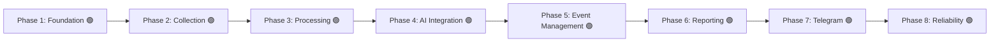

# نقشه راه توسعه (Development Roadmap)

این سند مراحل پیاده‌سازی و معیارهای پذیرش (Acceptance Criteria) هر فاز را طبق بندهای ۱۲ و ۱۳ سند راهنمای پروژه مشخص می‌کند.

---

## بررسی اجمالی فازها

> **یادداشت حاکمیتی ممیزی ۲۰۲۶-۱۱-۱۱:**
> - **Phase 2:** بدون تأیید اجرا شد، در ممیزی 2026-11-11 بازبینی و تأیید شد
> - **Phase 3:** بدون تأیید اجرا شد، در ممیزی 2026-11-11 بازبینی و تأیید شد (ISS-004)
> - **Phase 4:** بدون تأیید اجرا شد، در ممیزی 2026-11-11 بازبینی و تأیید شد (ISS-005, ISS-006)
> - **Phase 5:** بدون تأیید اجرا شد، در ممیزی 2026-11-11 بازبینی و تأیید شد (ISS-007)
> - **Phase 6:** بدون تأیید اجرا شد، در ممیزی 2026-11-11 بازبینی و تأیید شد
> - **Phase 7:** بدون تأیید اجرا شد، در ممیزی 2026-11-11 بازبینی و تأیید شد (ISS-008)
> - **Phase 8:** بدون تأیید اجرا شد، در ممیزی 2026-11-11 بازبینی و تأیید شد (ISS-025)

---

## شرح تفصیلی فازها و معیارهای پذیرش

### فاز ۱ — زیرساخت و پایه‌ها (Phase 1 — Project Foundation) 🟢 [تکمیل‌شده]
- **اهداف:**
  - ساماندهی وابستگی‌ها در `requirements.txt` و `requirements-dev.txt` (افزودن Alembic، greenlet، pytest، pytest-asyncio).
  - راه‌اندازی ساختار رسمی مهاجرت دیتابیس با Alembic و نخستین ریویژن اسکیما.
  - اصلاح لودینگ تنظیمات در `app/config.py` جهت پشتیبانی از تست‌ها بدون الزام به وجود فایل تولیدی `.env`.
  - استقرار چارچوب آزمون (Testing Framework) با ۱۶ تست واحد اولیه.
- **معیار پذیرش (محقق‌شده):**
  - دستور `alembic upgrade head --sql` جداول و ایندکس‌ها را با موفقیت تولید می‌کند.
  - ایمپورت تمامی ماژول‌های پروژه بدون خطای سینتکس یا خطای عدم متغیرهای محیطی انجام می‌شود.
  - تمامی ۱۶ تست با موفقیت اجرا شده و ۱۰۰٪ سبز هستند (پوشش ۴۰٪ کل پروژه).
- **وضعیت واقعی:**
  - کد پیاده‌سازی: ✅ (کامیت‌های فاز ۱)
  - تست: ✅ پوشش در `tests/test_config.py`, `tests/test_models.py`, `tests/test_alembic.py`
  - تأیید مستقل در ممیزی: ✅ (2026-11-10)

---

### فاز ۲ — دریافت و ثبت اخبار (Phase 2 — News Collection) 🟢 [بازبینی و تأیید در ممیزی]
- **اهداف:**
  - ارتقای کلاینت RSS در `app/collectors/rss_collector.py` با پشتیبانی از مکانیزم Retry نمایی، محدودیت زمانی (Timeout) و هدرهای استاندارد.
  - ایزوله‌سازی خطاهای مربوط به هر فید و ثبت خطاها در لاگ به گونه‌ای که شکست یک منبع مانع پردازش منابع دیگر نشود.
  - افزودن ماژول استخراج محتوا (`Trafilatura`) جهت استخراج متن اصلی بدنه و زدودن تبلیغات از صفحات وب در صورت نیاز.
- **معیار پذیرش:**
  - دریافت موفقیت‌آمیز فیدها با شبیه‌سازی شبکه‌ای (Mock httpx) و ذخیره داده‌ها در تست‌های مجزا.
- **وضعیت واقعی:**
  - کد پیاده‌سازی: ✅ (کامیت‌های ea5d68a تا e517ffd)
  - تست: ✅ پوشش در `tests/test_collectors.py`
  - تأیید مستقل در ممیزی: ✅ (2026-11-11)

---

### فاز ۳ — پالایش، نرمال‌سازی و تکرارزدایی (Phase 3 — Processing) 🟢 [بازبینی و تأیید در ممیزی]
- **اهداف:**
  - پالایش و نرمال‌سازی دقیق URLها و پاکسازی پارامترهای تبلیغاتی و نشست‌ها.
  - محاسبه هش یکتا (`content_hash`) روی متن و عنوان نرمال‌شده.
  - بررسی تکراری نبودن خبر هم از روی `canonical_url` و هم از روی `content_hash`.
  - استفاده از شاخص‌های بهینه دیتابیس برای جلوگیری از اسکن کامل جداول در چک تکرار.
- **معیار پذیرش:**
  - در صورت انتشار مجدد یک خبر با URL اندکی متفاوت اما متن یکسان، پردازش مجدد متوقف شود.
- **وضعیت واقعی:**
  - کد پیاده‌سازی: ✅ (کامیت‌های ea5d68a تا e517ffd)
  - تست: ✅ پوشش در `tests/test_collectors.py`
  - تأیید مستقل در ممیزی: ✅ (2026-11-11)

---

### فاز ۴ — ادغام هوش مصنوعی و خلاصه‌سازی (Phase 4 — AI Integration) 🟢 [بازبینی و تأیید در ممیزی]
- **اهداف:**
  - پیاده‌سازی لایه واسط انتزاعی `BaseAIProvider` و تفکیک ارائه‌دهنده `GeminiProvider`.
  - اعتبارسنجی دقیق خروجی طبق کدهای ده‌گانه دسته‌بندی (`POL`, `MIL`, `DIP`, ...) و پنج وضعیت راستی‌آزمایی (`confirmed`, ...).
  - تقویت پرامپت‌ها در برابر تزریق ورودی (Prompt Injection Defense).
  - مدیریت سهمیه مصرف (Rate Limit) و ثبت متادیتای مدل و پرامپت در جدول `summaries`.
- **معیار پذیرش:**
  - خروجی‌های نامعتبر توسط Pydantic اعتبارسنجی شده و هیچ ادعای بدون انتسابی به عنوان فکت تولید نشود.
- **وضعیت واقعی:**
  - کد پیاده‌سازی: ✅ (کامیت‌های ea5d68a تا e517ffd)
  - تست: ✅ پوشش در `tests/test_ai.py`
  - تأیید مستقل در ممیزی: ✅ (2026-11-11)

---

### فاز ۵ — مدیریت و انطباق رویدادها (Phase 5 — Event Management) 🟢 [بازبینی و تأیید در ممیزی]
- **اهداف:**
  - پیاده‌سازی موتور تطبیق رویدادها (`Event Matching`): خوشه‌بندی مقالات جدید با رویدادهای ۲۴ تا ۴۸ ساعت اخیر.
  - بررسی اشتراک مکان، بازیگران، کلمات کلیدی و تشابه برداری/متنی.
  - انتساب چند مقاله به یک رکورد `Event` در جدول `article_events`.
- **معیار پذیرش:**
  - چند مقاله از خبرگزاری‌های مختلف در مورد یک رویداد خاص به یک رکورد رویداد مشترک متصل شوند.
- **وضعیت واقعی:**
  - کد پیاده‌سازی: ✅ (کامیت‌های ea5d68a تا e517ffd)
  - تست: ✅ پوشش در `tests/test_event_matcher.py` و `tests/test_pipeline.py`
  - تأیید مستقل در ممیزی: ✅ (2026-11-11)

---

### فاز ۶ — تدوین گزارش جامع روزانه (Phase 6 — Reporting) 🟢 [بازبینی و تأیید در ممیزی]
- **اهداف:**
  - فیلتر کردن رویدادهای ۲۴ ساعت گذشته بر اساس درجه اهمیت (`importance >= min_importance`).
  - جلوگیری از نمایش چندباره یک رویداد در گزارش.
  - قالب‌بندی متنی زیبا، خوانا و تفکیک‌شده به زبان فارسی طبق استاندارد تحریریه.
  - ذخیره نسخه نهایی گزارش در جدول `daily_reports` با وضعیت `generated`.
- **معیار پذیرش:**
  - گزارش حاوی تیترها، خلاصه‌ها، منابع، وضعیت راستی‌آزمایی و لینک‌های معتبر بدون شکستگی فرمت باشد.
- **وضعیت واقعی:**
  - کد پیاده‌سازی: ✅ (کامیت‌های ea5d68a تا e517ffd)
  - تست: ✅ پوشش در `tests/test_daily_report.py`
  - تأیید مستقل در ممیزی: ✅ (2026-11-11)

---

### فاز ۷ — انتشار در تلگرام و مدیریت خطا (Phase 7 — Telegram Publisher) 🟢 [بازبینی و تأیید در ممیزی]
- **اهداف:**
  - ارسال گزارش به کانال رسمی تلگرام و ارسال موازی به چت خصوصی ادمین.
  - قطعه‌بندی هوشمند متن‌های طولانی به پیام‌های کمتر از ۴۰۰۰ کاراکتر با بستن تگ‌های ناقص HTML.
  - مدیریت خطاهای تلگرام (FloodWait، اتصال ضعیف) با Retry.
  - به‌روزرسانی رکوردهای `daily_reports` و ثبت شناسه‌های پیام (`telegram_message_ids`).
- **معیار پذیرش:**
  - گزارش با موفقیت در کانال و چت ادمین ارسال و وضعیت رکورد به `published` تغییر یابد.
- **وضعیت واقعی:**
  - کد پیاده‌سازی: ✅ (کامیت‌های ea5d68a تا e517ffd)
  - تست: ✅ پوشش در `tests/test_telegram_publisher.py`
  - تأیید مستقل در ممیزی: ✅ (2026-11-11)

---

### فاز ۸ — پایداری، آزمون فراگیر و بهینه‌سازی (Phase 8 — Reliability) 🟢 [بازبینی و تأیید در ممیزی]
- **اهداف:**
  - پوشش تست واحد و یکپارچگی برای تمامی ماژول‌ها با Mockهای استاندارد.
  - اعتبارسنجی لاگ‌ها در جدول `job_logs` و چرخش لاگ‌های سیستمی.
  - تست پایداری بلندمدت و مصرف حافظه.
- **معیار پذیرش:**
  - اجرای خودکار ربات در یک چرخه کامل بدون نشتی حافظه و بدون کرش ناشی از قطعی شبکه.
- **وضعیت واقعی:**
  - کد پیاده‌سازی: ✅ (کامیت‌های ea5d68a تا e517ffd)
  - تست: ✅ پوشش در `tests/test_pipeline_integration.py`، `tests/test_scheduler_contracts.py` و `tests/test_gemini_rotator.py`
  - تأیید مستقل در ممیزی: ✅ (2026-11-11)
