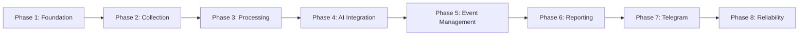

# نقشه راه توسعه (Development Roadmap)

این سند مراحل پیاده‌سازی و معیارهای پذیرش (Acceptance Criteria) هر فاز را طبق بندهای ۱۲ و ۱۳ سند راهنمای پروژه مشخص می‌کند.

---

## بررسی اجمالی فازها

---

## شرح تفصیلی فازها و معیارهای پذیرش

### فاز ۱ — زیرساخت و پایه‌ها (Phase 1 — Project Foundation) 🟡 [در دست اقدام]
- **اهداف:**
  - ساماندهی وابستگی‌ها در `requirements.txt` و `requirements-dev.txt` (افزودن Alembic، pytest، pytest-asyncio).
  - راه‌اندازی ساختار رسمی مهاجرت دیتابیس با Alembic.
  - اصلاح لودینگ تنظیمات در `app/config.py` جهت پشتیبانی از تست‌ها بدون الزام به وجود فایل تولیدی `.env`.
  - استقرار چارچوب آزمون (Testing Framework) با چند تست Smoke اولیه.
- **معیار پذیرش:**
  - دستور `alembic upgrade head` جداول را با موفقیت تولید کند.
  - ایمپورت ماژول‌های پروژه بدون خطای سینتکس یا خطای عدم متغیرهای محیطی در تست‌ها انجام شود.
  - سوئیت تست اجرا شده و سبز شود.

---

### فاز ۲ — دریافت و ثبت اخبار (Phase 2 — News Collection) ⚪ [آتی]
- **اهداف:**
  - ارتقای کلاینت RSS در `app/collectors/rss_collector.py` با پشتیبانی از مکانیزم Retry نمایی، محدودیت زمانی (Timeout) و هدرهای استاندارد.
  - ایزوله‌سازی خطاهای مربوط به هر فید و جلوگیری از توقف خط لوله در اثر شکست یک منبع.
  - یکپارچه‌سازی ماژول استخراج محتوا (`Trafilatura`) برای صفحاتی که متن کامل فید را ارائه نمی‌دهند.
- **معیار پذیرش:**
  - ذخیره مقالات دریافتی در جدول `articles` بدون خطای پایگاه داده و ثبت دقیق زمان‌های `published_at` و `collected_at`.

---

### فاز ۳ — پالایش، نرمال‌سازی و تکرارزدایی (Phase 3 — Processing) ⚪ [آتی]
- **اهداف:**
  - پالایش و نرمال‌سازی دقیق URLها و پاکسازی پارامترهای تبلیغاتی و نشست‌ها.
  - محاسبه هش یکتا (`content_hash`) روی متن و عنوان نرمال‌شده.
  - بررسی تکراری نبودن خبر هم از روی `canonical_url` و هم از روی `content_hash`.
  - ایجاد شاخص‌های بهینه دیتابیس برای جلوگیری از اسکن کامل جداول در چک تکرار.
- **معیار پذیرش:**
  - در صورت انتشار مجدد یک خبر با URL اندکی متفاوت اما متن یکسان، پردازش مجدد متوقف شود.

---

### فاز ۴ — ادغام هوش مصنوعی و خلاصه‌سازی (Phase 4 — AI Integration) ⚪ [آتی]
- **اهداف:**
  - پیاده‌سازی لایه واسط انتزاعی `BaseAIProvider` و تفکیک ارائه‌دهنده `GeminiProvider`.
  - اعتبارسنجی دقیق خروجی طبق کدهای ده‌گانه دسته‌بندی (`POL`, `MIL`, `DIP`, ...) و پنج وضعیت راستی‌آزمایی (`confirmed`, ...).
  - تقویت پرامپت‌ها در برابر تزریق ورودی (Prompt Injection Defense).
  - مدیریت سهمیه مصرف (Rate Limit) و ثبت متادیتای مدل و پرامپت در جدول `summaries`.
- **معیار پذیرش:**
  - خروجی‌های نامعتبر توسط Pydantic اعتبارسنجی شده و هیچ ادعای بدون انتسابی به عنوان فکت تولید نشود.

---

### فاز ۵ — مدیریت و انطباق رویدادها (Phase 5 — Event Management) ⚪ [آتی]
- **اهداف:**
  - پیاده‌سازی موتور تطبیق رویدادها (`Event Matching`): آیا مقاله جدید مربوط به یک رویداد در ۲۴ تا ۴۸ ساعت اخیر است یا رویداد جدیدی است؟
  - بررسی اشتراک مکان، بازیگران، کلمات کلیدی و تشابه برداری/متنی.
  - انتساب چند مقاله به یک رکورد `Event` در جدول `article_events`.
- **معیار پذیرش:**
  - چند مقاله از خبرگزاری‌های مختلف در مورد یک حمله یا نشست خاص به یک رویداد مشترک متصل شوند بدون تکثیر بی‌مورد رکورد `Event`.

---

### فاز ۶ — تدوین گزارش جامع روزانه (Phase 6 — Reporting) ⚪ [آتی]
- **اهداف:**
  - فیلتر کردن رویدادهای ۲۴ ساعت گذشته بر اساس درجه اهمیت (`importance >= min_importance`).
  - جلوگیری از نمایش چندباره یک رویداد در گزارش.
  - قالب‌بندی متنی زیبا، خوانا و تفکیک‌شده به زبان فارسی طبق استاندارد تحریریه.
  - ذخیره نسخه نهایی گزارش در جدول `daily_reports` با وضعیت `generated`.
- **معیار پذیرش:**
  - گزارش حاوی تیترها، خلاصه‌ها، منابع، وضعیت راستی‌آزمایی و لینک‌های معتبر بدون شکستگی فرمت باشد.

---

### فاز ۷ — انتشار در تلگرام و مدیریت خطا (Phase 7 — Telegram Publisher) ⚪ [آتی]
- **اهداف:**
  - ارسال گزارش به کانال رسمی تلگرام و ارسال موازی به چت خصوصی ادمین.
  - قطعه‌بندی هوشمند متن‌های طولانی به پیام‌های کمتر از ۴۰۰۰ کاراکتر با بستن تگ‌های ناقص HTML.
  - مدیریت خطاهای تلگرام (FloodWait، اتصال ضعیف) با Retry.
  - به‌روزرسانی رکوردهای `daily_reports` و ثبت شناسه‌های پیام (`telegram_message_ids`).
- **معیار پذیرش:**
  - گزارش با موفقیت در کانال و چت ادمین ارسال و وضعیت رکورد به `published` تغییر یابد.

---

### فاز ۸ — پایداری، آزمون فراگیر و بهینه‌سازی (Phase 8 — Reliability) ⚪ [آتی]
- **اهداف:**
  - پوشش تست واحد و یکپارچگی برای تمامی ماژول‌ها با Mockهای استاندارد.
  - اعتبارسنجی لاگ‌ها در جدول `job_logs` و چرخش لاگ‌های سیستمی.
  - تست پایداری بلندمدت و مصرف حافظه.
- **معیار پذیرش:**
  - اجرای خودکار ربات در یک چرخه کامل بدون نشتی حافظه، بدون کرش ناشی از قطعی شبکه و با ثبت دقیق وضعیت‌ها.
