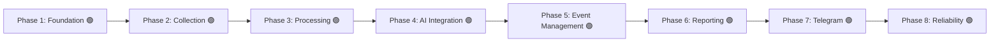

# نقشه راه توسعه (Development Roadmap)

این سند مراحل پیاده‌سازی و معیارهای پذیرش (Acceptance Criteria) هر فاز را طبق بندهای ۱۲ و ۱۳ سند راهنمای پروژه مشخص می‌کند.

---

## بررسی اجمالی فازها

> **یادداشت حاکمیتی ممیزی ۲۰۲۶-۱۱-۱۱:**
> - **Phase 2:** بدون تأیید اجرا شد، در ممیزی 2026-11-11 بازبینی و تأیید شد
> - **Phase 3:** بدون تأیید اجرا شد، در ممیزی 2026-11-11 بازبینی و تأیید شد (ISS-004)
> - **Phase 4:** بدون تأیید اجرا شد، در ممیزی 2026-11-11 بازبینی و تأیید شد (ISS-005, ISS-006)
> - **Phase 5:** بدون تأیید اجرا شد، در ممیزی 2026-11-11 بازبینی و تأیید شد (ISS-007)
> - **Phase 6:** بدون تأیید اجرا شد، در ممیزی 2026-11-11 بازبینی و تأیید شد
> - **Phase 7:** بدون تأیید اجرا شد، در ممیزی 2026-11-11 بازبینی و تأیید شد (ISS-008)
> - **Phase 8:** بدون تأیید اجرا شد، در ممیزی 2026-11-11 بازبینی و تأیید شد (ISS-025)

---

## شرح تفصیلی فازها و معیارهای پذیرش

### فاز ۱ — زیرساخت و پایه‌ها (Phase 1 — Project Foundation) 🟢 [تکمیل‌شده]
- **اهداف:**
  - ساماندهی وابستگی‌ها در `requirements.txt` و `requirements-dev.txt` (افزودن Alembic، greenlet، pytest، pytest-asyncio).
  - راه‌اندازی ساختار رسمی مهاجرت دیتابیس با Alembic و نخستین ریویژن اسکیما.
  - اصلاح لودینگ تنظیمات در `app/config.py` جهت پشتیبانی از تست‌ها بدون الزام به وجود فایل تولیدی `.env`.
  - استقرار چارچوب آزمون (Testing Framework) با ۱۶ تست واحد اولیه.
- **معیار پذیرش (محقق‌شده):**
  - دستور `alembic upgrade head --sql` جداول و ایندکس‌ها را با موفقیت تولید می‌کند.
  - ایمپورت تمامی ماژول‌های پروژه بدون خطای سینتکس یا خطای عدم متغیرهای محیطی انجام می‌شود.
  - تمامی ۱۶ تست با موفقیت اجرا شده و ۱۰۰٪ سبز هستند (پوشش ۴۰٪ کل پروژه).
- **وضعیت واقعی:**
  - کد پیاده‌سازی: ✅ (کامیت‌های فاز ۱)
  - تست: ✅ پوشش در `tests/test_config.py`, `tests/test_models.py`, `tests/test_alembic.py`
  - تأیید مستقل در ممیزی: ✅ (2026-11-10)

---

### فاز ۲ — دریافت و ثبت اخبار (Phase 2 — News Collection) 🟢 [بازبینی و تأیید در ممیزی]
- **اهداف:**
  - ارتقای کلاینت RSS در `app/collectors/rss_collector.py` با پشتیبانی از مکانیزم Retry نمایی، محدودیت زمانی (Timeout) و هدرهای استاندارد.
  - ایزوله‌سازی خطاهای مربوط به هر فید و ثبت خطاها در لاگ به گونه‌ای که شکست یک منبع مانع پردازش منابع دیگر نشود.
  - افزودن ماژول استخراج محتوا (`Trafilatura`) جهت استخراج متن اصلی بدنه و زدودن تبلیغات از صفحات وب در صورت نیاز.
- **معیار پذیرش:**
  - دریافت موفقیت‌آمیز فیدها با شبیه‌سازی شبکه‌ای (Mock httpx) و ذخیره داده‌ها در تست‌های مجزا.
- **وضعیت واقعی:**
  - کد پیاده‌سازی: ✅ (کامیت‌های ea5d68a تا e517ffd)
  - تست: ✅ پوشش در `tests/test_collectors.py`
  - تأیید مستقل در ممیزی: ✅ (2026-11-11)

---

### فاز ۳ — پالایش، نرمال‌سازی و تکرارزدایی (Phase 3 — Processing) 🟢 [بازبینی و تأیید در ممیزی]
- **اهداف:**
  - پالایش و نرمال‌سازی دقیق URLها و پاکسازی پارامترهای تبلیغاتی و نشست‌ها.
  - محاسبه هش یکتا (`content_hash`) روی متن و عنوان نرمال‌شده.
  - بررسی تکراری نبودن خبر هم از روی `canonical_url` و هم از روی `content_hash`.
  - استفاده از شاخص‌های بهینه دیتابیس برای جلوگیری از اسکن کامل جداول در چک تکرار.
- **معیار پذیرش:**
  - در صورت انتشار مجدد یک خبر با URL اندکی متفاوت اما متن یکسان، پردازش مجدد متوقف شود.
- **وضعیت واقعی:**
  - کد پیاده‌سازی: ✅ (کامیت‌های ea5d68a تا e517ffd)
  - تست: ✅ پوشش در `tests/test_collectors.py`
  - تأیید مستقل در ممیزی: ✅ (2026-11-11)

---

### فاز ۴ — ادغام هوش مصنوعی و خلاصه‌سازی (Phase 4 — AI Integration) 🟢 [بازبینی و تأیید در ممیزی]
- **اهداف:**
  - پیاده‌سازی لایه واسط انتزاعی `BaseAIProvider` و تفکیک ارائه‌دهنده `GeminiProvider`.
  - اعتبارسنجی دقیق خروجی طبق کدهای ده‌گانه دسته‌بندی (`POL`, `MIL`, `DIP`, ...) و پنج وضعیت راستی‌آزمایی (`confirmed`, ...).
  - تقویت پرامپت‌ها در برابر تزریق ورودی (Prompt Injection Defense).
  - مدیریت سهمیه مصرف (Rate Limit) و ثبت متادیتای مدل و پرامپت در جدول `summaries`.
- **معیار پذیرش:**
  - خروجی‌های نامعتبر توسط Pydantic اعتبارسنجی شده و هیچ ادعای بدون انتسابی به عنوان فکت تولید نشود.
- **وضعیت واقعی:**
  - کد پیاده‌سازی: ✅ (کامیت‌های ea5d68a تا e517ffd)
  - تست: ✅ پوشش در `tests/test_ai.py`
  - تأیید مستقل در ممیزی: ✅ (2026-11-11)

---

### فاز ۵ — مدیریت و انطباق رویدادها (Phase 5 — Event Management) 🟢 [بازبینی و تأیید در ممیزی]
- **اهداف:**
  - پیاده‌سازی موتور تطبیق رویدادها (`Event Matching`): خوشه‌بندی مقالات جدید با رویدادهای ۲۴ تا ۴۸ ساعت اخیر.
  - بررسی اشتراک مکان، بازیگران، کلمات کلیدی و تشابه برداری/متنی.
  - انتساب چند مقاله به یک رکورد `Event` در جدول `article_events`.
- **معیار پذیرش:**
  - چند مقاله از خبرگزاری‌های مختلف در مورد یک رویداد خاص به یک رکورد رویداد مشترک متصل شوند.
- **وضعیت واقعی:**
  - کد پیاده‌سازی: ✅ (کامیت‌های ea5d68a تا e517ffd)
  - تست: ✅ پوشش در `tests/test_event_matcher.py` و `tests/test_pipeline.py`
  - تأیید مستقل در ممیزی: ✅ (2026-11-11)

---

### فاز ۶ — تدوین گزارش جامع روزانه (Phase 6 — Reporting) 🟢 [بازبینی و تأیید در ممیزی]
- **اهداف:**
  - فیلتر کردن رویدادهای ۲۴ ساعت گذشته بر اساس درجه اهمیت (`importance >= min_importance`).
  - جلوگیری از نمایش چندباره یک رویداد در گزارش.
  - قالب‌بندی متنی زیبا، خوانا و تفکیک‌شده به زبان فارسی طبق استاندارد تحریریه.
  - ذخیره نسخه نهایی گزارش در جدول `daily_reports` با وضعیت `generated`.
- **معیار پذیرش:**
  - گزارش حاوی تیترها، خلاصه‌ها، منابع، وضعیت راستی‌آزمایی و لینک‌های معتبر بدون شکستگی فرمت باشد.
- **وضعیت واقعی:**
  - کد پیاده‌سازی: ✅ (کامیت‌های ea5d68a تا e517ffd)
  - تست: ✅ پوشش در `tests/test_daily_report.py`
  - تأیید مستقل در ممیزی: ✅ (2026-11-11)

---

### فاز ۷ — انتشار در تلگرام و مدیریت خطا (Phase 7 — Telegram Publisher) 🟢 [بازبینی و تأیید در ممیزی]
- **اهداف:**
  - ارسال گزارش به کانال رسمی تلگرام و ارسال موازی به چت خصوصی ادمین.
  - قطعه‌بندی هوشمند متن‌های طولانی به پیام‌های کمتر از ۴۰۰۰ کاراکتر با بستن تگ‌های ناقص HTML.
  - مدیریت خطاهای تلگرام (FloodWait، اتصال ضعیف) با Retry.
  - به‌روزرسانی رکوردهای `daily_reports` و ثبت شناسه‌های پیام (`telegram_message_ids`).
- **معیار پذیرش:**
  - گزارش با موفقیت در کانال و چت ادمین ارسال و وضعیت رکورد به `published` تغییر یابد.
- **وضعیت واقعی:**
  - کد پیاده‌سازی: ✅ (کامیت‌های ea5d68a تا e517ffd)
  - تست: ✅ پوشش در `tests/test_telegram_publisher.py`
  - تأیید مستقل در ممیزی: ✅ (2026-11-11)

---

### فاز ۸ — پایداری، آزمون فراگیر و بهینه‌سازی (Phase 8 — Reliability) 🟢 [بازبینی و تأیید در ممیزی]
- **اهداف:**
  - پوشش تست واحد و یکپارچگی برای تمامی ماژول‌ها با Mockهای استاندارد.
  - اعتبارسنجی لاگ‌ها در جدول `job_logs` و چرخش لاگ‌های سیستمی.
  - تست پایداری بلندمدت و مصرف حافظه.
- **معیار پذیرش:**
  - اجرای خودکار ربات در یک چرخه کامل بدون نشتی حافظه و بدون کرش ناشی از قطعی شبکه.
- **وضعیت واقعی:**
  - کد پیاده‌سازی: ✅ (کامیت‌های ea5d68a تا e517ffd)
  - تست: ✅ پوشش در `tests/test_pipeline_integration.py`، `tests/test_scheduler_contracts.py` و `tests/test_gemini_rotator.py`
  - تأیید مستقل در ممیزی: ✅ (2026-11-11)

---

### فاز H — استقرار و CI/CD (Phase H — Deployment & CI) 🟢 [تکمیل‌شده]

- **اهداف محقق‌شده:**
  - **H-1:** Dockerfile چندمرحله‌ای (python:3.15.2-slim) + docker-compose + اسکریپت deploy
  - **H-2:** GitHub Actions (pytest + ruff) کاملاً سبز
  - **H-3:** اسکریپت‌های Backup/Restore به Cloudflare R2 + مستندات
  - **H-4:** مستندات DEPLOYMENT.md، ANTI_IDLE.md، keepalive.sh، README و LOCAL_SETUP
- **معیار پذیرش (محقق‌شده):**
  - CI در GitHub Actions برای هر push اجرا و پاس می‌شود.
  - معماری Zero-Cost (هزینه ماهانه صفر) مستند شده است.
  - بکاپ خودکار و سناریوی بازیابی مستند شده است.

---

### فاز J — رفع باگ‌های بحرانی و پایدارسازی CI (Phase J — Critical Bugfixes & CI Stabilization) 🟢 [تکمیل‌شده]

- **اهداف محقق‌شده:**
  - **J-1:** اصلاح نسخه پایتون در ورک‌فلوهای GitHub Actions به `3.15` با `allow-prereleases: true`
  - **J-2:** رفع ۴ خطای Ruff که در کامیت‌های اورژانسی بازگشته بود
  - **J-3:** جداسازی جمع‌آوری از پردازش (`collect_new_articles` / `process_collected_articles`)
  - **J-4:** پنجره گزارش ۲۴ ساعته با لنگر ساعت گزارش (`report_window`)
  - **J-5:** افزودن `editorial/` به ایمیج Docker
  - **J-6:** بستن Providerهای موقت در `check_any_model_available`
  - **J-7:** جداسازی DSN برای `asyncpg` و `psycopg` (حذف `sslmode`/`sslrootcert` از URL و ساخت `SSLContext`)
  - **J-8:** نگاشت وفادار به libpq برای `sslmode` در asyncpg: `require` → رمزنگاری بدون اعتبارسنجی (`CERT_NONE`)، `verify-ca` → اعتبارسنجی زنجیره، `verify-full` → اعتبارسنجی زنجیره و hostname؛ پشتیبانی اختیاری از `POSTGRES_SSLROOTCERT` برای ارتقا به اعتبارسنجی کامل بدون تغییر کد
- **معیار پذیرش (محقق‌شده):**
  - ۱۷۷ تست پاس و پوشش کلی ۸۸٪.
  - `ruff check .` بدون خطا.
  - جمع‌آوری اخبار مستقل از خالی بودن صف و قطعی مدل‌ها انجام می‌شود.
  - هیچ بازه‌ای از شبانه‌روز از پنجره گزارش بیرون نمی‌ماند.
- **وضعیت واقعی:**
  - کد پیاده‌سازی: ✅ (کامیت‌های 513b86a تا c9e91c6)
  - تأیید مستقل: ✅ (2026-11-12)

---

### فاز K — پایدارسازی پردازش، منابع جدید و ارسال لحظه‌ای (Phase K — Processing Resilience & Instant Delivery) 🟢 [تکمیل‌شده]

- **اهداف محقق‌شده:**
  - **K-1 (D-1):** ذخیره تدریجی هر مقاله (`commit` به‌ازای هر مقاله) تا قطع اجرا هیچ تحلیل موفقی را از بین نبرد.
  - **K-2 (D-2):** ستون‌های `attempt_count`/`last_attempt_at` و انتخاب مجدد مقالات `failed` تا سقف `AI_MAX_ATTEMPTS`.
  - **K-3 (D-3):** قطع‌کننده سیل خطا (Circuit Breaker) با `AI_MAX_CONSECUTIVE_FAILURES`؛ صف باقی‌مانده دست‌نخورده می‌ماند.
  - **K-4 (D-4):** تلاش مجدد یک‌باره با `purpose='schema_repair'` وقتی مدل JSON بریده/نامعتبر برمی‌گرداند.
  - **K-5:** افزودن ۷ منبع جدید (Al Jazeera Arabic، Foreign Affairs، Reuters، AP، NYT، Washington Post، Euronews) با جایگزین‌های زنده برای فیدهای 403/406.
  - **K-6:** ارسال لحظه‌ای تحلیل‌های فارسی به کانال تلگرام با سقف `IMMEDIATE_PUBLISH_MAX_PER_RUN`، فاصله‌گذاری برای FloodWait، فقط رویدادهای تازه، و احترام کامل به `DRY_RUN_DAILY_REPORT`.
- **معیار پذیرش (محقق‌شده):**
  - اجرای ابری واقعی در ۳۳ دقیقه سبز شد: ۱۵ مقاله پردازش و commit شد، صفر مقاله `failed` با وجود ۲۹ خطای ۵۰۳ و ۲۷ خطای ۴۲۹، و ۱۰ ارسال لحظه‌ای در حالت `[DRY RUN]`.
  - ۱۷۷ تست پاس و `ruff check .` بدون خطا.
- **وضعیت واقعی:**
  - کد پیاده‌سازی: ✅ (کامیت‌های 257f10c تا 08e5382)
  - تأیید مستقل: ✅ (2026-11-12)

---

### فاز L — استقرار تولیدی و مستندسازی نهایی (Phase L — Production Deployment & Documentation) 🟢 [تکمیل‌شده]

- **اهداف محقق‌شده:**
  - اتصال موفق به Aiven PostgreSQL روی GitHub Actions (SSL، مایگریشن خودکار، اجرای کامل خط لوله).
  - سبز شدن کامل ورک‌فلوهای `ci.yml` و `cron.yml` روی مخزن عمومی.
  - بازبینی امنیتی تاریخچه گیت پیش از عمومی‌سازی (بدون هیچ راز کامیت‌شده) و سخت‌سازی `.gitignore` برای همه‌ی نسخه‌های `.env`.
  - هم‌راستاسازی مستندات مرجع (`ROADMAP`، `DATABASE_SCHEMA`)، `DEVELOPMENT_LOG`، `README` و `DEPLOYMENT` با وضعیت واقعی کد.
- **معیار پذیرش (محقق‌شده):**
  - اجرای زمان‌بندی‌شده بدون مداخله دستی، با گزارش روزانه و ارسال لحظه‌ای در یک چرخه کامل.
- **بدهی فنی شناخته‌شده:**
  - `fetch_feed` متن کامل همه‌ی آیتم‌های فید را با Trafilatura دانلود می‌کند؛ در آخرین اجرا ۳۵۵ استخراج انجام شد و زمان اجرا را به ~۳۳ دقیقه رساند. تسک آینده: دریافت فقط متادیتا در مرحله جمع‌آوری و استخراج متن کامل صرفاً برای مقالات انتخابی مرحله پردازش.
- **وضعیت واقعی:**
  - تأیید مستقل: ✅ (2026-11-12)

---

### فاز N — سخت‌سازی اجرا و گارد زبان فارسی (Phase N — Run Hardening & Persian Language Guard) 🟢 [تکمیل‌شده]

- **اهداف محقق‌شده:**
  - افزایش `timeout-minutes` ورک‌فلو `cron.yml` از ۴۵ به ۹۰ دقیقه؛ دو اجرای متوالی پیش از این فاز روی سقف ۴۵ دقیقه `cancelled` شده بودند و مرحله گزارش روزانه هرگز اجرا نشد.
  - تبدیل بلوک‌های `print()` حالت `[DRY RUN]` در `app/telegram/publisher.py` به `logger.info()`؛ بافر بلاک‌شده‌ی stdout در جاب لغوشده فلاش نمی‌شد و شواهد پیش‌نمایش از بین می‌رفت.
  - گارد زبان فارسی: بند ۹ پرامپت سیستم + `field_validator` روی `headline_fa` و `summary_fa` که نسبت حروف فارسی (≥ ۷۰٪) و سهم حروف مخصوص عربی (`ي ك ة ى` ≤ ۲٪) را می‌سنجد. خطای اعتبارسنجی از مسیر موجود `schema_repair` عبور می‌کند و مدل وادار به تولید فارسی می‌شود.
- **معیار پذیرش (محقق‌شده):**
  - ۲۱۰ تست پاس (۳ تست جدید گارد زبان + بازنویسی تست dry-run به `caplog`)، `ruff` پاک، CI سبز روی `5a59a14`‏.
  - شاهد چاپی `TELEGRAM IMMEDIATE PUBLISHER [DRY RUN]` همراه `Verification:` و `Delivery:` در لاگ اجرای زنده `43387266312`.
- **وضعیت واقعی:**
  - کد پیاده‌سازی: ✅ (کامیت‌های `b22f2c9`، `3d07116`، `91a1793`)
  - تأیید مستقل: ✅ (2026-11-13)

---

### فاز O — حذف بدهی فنی استخراج متن (Phase O — Lazy Body Extraction) 🟢 [تکمیل‌شده]

- **اهداف محقق‌شده:**
  - جمع‌آوری فیدها اکنون فقط متادیتا می‌خواند: `fetch_feed(..., extract_full_text=False, min_summary_length=0)`.
  - تابع `_hydrate_article_body` متن کامل را تنبل و یک‌بار برای هر مقاله‌ی واردشده به صف تحلیل استخراج می‌کند؛ شکست استخراج باعث حذف خبر نمی‌شود و خلاصه RSS تحلیل می‌شود.
  - `content_hash` دست‌نخورده ماند تا یکتایی و تکرارزدایی تغییر نکند.
  - تست‌ها آفلاین شدند: فیکسچر autouse مانع درخواست واقعی بدنه مقاله می‌شود؛ `tests/test_article_hydration.py` چهار حالت را پوشش می‌دهد.
- **معیار پذیرش (محقق‌شده):**
  - اجرای زنده `43387266312`: ۳۵۳ آیتم فید با **صفر** فراخوانی Trafilatura در مرحله جمع‌آوری، زمان کل ۶ دقیقه و ۲۷ ثانیه (پیش‌تر: بیش از ۴۵ دقیقه و لغو)، و اجرای موفق گزارش روزانه برای نخستین بار.
  - ۲۱۰ تست پاس، `ruff` پاک، CI سبز روی `5a59a14`.
- **بدهی باقی‌مانده:**
  - مسیر تنبل در این اجرا فعال نشد چون ۱۵ مقاله‌ی صف از اجرای قبلی متن کامل ذخیره‌شده داشتند؛ اولین اجرایی که مقاله‌ی تازه‌ی `rss_summary` پردازش کند این مسیر را در عمل می‌سنجد.
- **وضعیت واقعی:**
  - کد پیاده‌سازی: ✅ (کامیت `5a59a14`)
  - تأیید مستقل: ✅ (2026-11-13)

---

### فاز P — سخت‌گیرانه کردن گیت منطقه‌ای (Phase P — Primary-Actor Gate) 🟢 [تکمیل‌شده]

- **اهداف محقق‌شده:**
  - تابع `is_primary_actor(countries, actors, location)` در `app/editorial/regions.py`: کشوری که فقط در فهرست `countries` آمده کافی نیست؛ باید در `actors` هم نام‌برده شود یا `location` خودش یک مکان منطقه‌ای باشد.
  - افزودن `mentions_middle_east_place` و مجموعه‌ی `MIDDLE_EAST_CITIES` (تهران، قاهره، قدس، بغداد، …) چون تحلیل‌ها معمولاً شهر را به‌جای کشور نام می‌برند و گیت کشورمحور خبرهای درون‌محدوده را رد می‌کرد.
  - تطبیق نام کشورها بین انگلیسی و فارسی (`MIDDLE_EAST_COUNTRY_ALIASES`) تا `countries` انگلیسی با `actors` فارسی هم‌خوان شود.
  - گیت جدید در `pipeline.py` به‌صورت لایه‌ی سوم پس از `is_relevant` و `has_middle_east_nexus` اعمال شد.
- **معیار پذیرش (محقق‌شده):**
  - اجرای زنده `43389312433` (sha `912f60f`): خبر `Article ID 197` با `countries=['ایالات متحده آمریکا','ایران']` و `actors=['وزارت خزانه‌داری ایالات متحده آمریکا','اسکات بسنت']` با دلیل «Middle East is only a passing mention» رد شد.
  - ۵ پیام لحظه‌ای (سقف ۵)، ۲ مورد ادمین، گزارش روزانه ۲۰ آیتمی، `215 passed, 14 skipped`، `ruff` پاک.
- **وضعیت واقعی:**
  - کد پیاده‌سازی: ✅ (کامیت `912f60f`)
  - تأیید مستقل: ✅ (2026-11-13)

---

### فاز Q — بهینه‌سازی مسیر مدل: تک‌تلاش، Timeout و Circuit Breaker (Phase Q — Model Path Optimization) 🟢 [تکمیل‌شده]

- **اهداف محقق‌شده:**
  - `RotatorConfig(max_retries=1)` در `app/ai/provider.py`: تلاش سوم روی مدلِ در دسترس‌نیست فقط تأخیر اضافه می‌کرد.
  - سقف زمانی صریح برای هر فراخوانی مدل: تنظیم جدید `ai_request_timeout_seconds` (پیش‌فرض ۳۰ ثانیه) که `rotator.execute` را در `asyncio.wait_for` می‌پیچد؛ در تولید دو فراخوانی ۷۲۲ و ۹۴۱ ثانیه بلاک شده بودند.
  - Circuit breaker در سطح مدل: پس از ۲ شکست متوالی مدل اصلی، بقیه‌ی همان اجرا مستقیماً از fallback استفاده می‌کند (`PRIMARY_FAILURE_THRESHOLD = 2`).
  - `TimeoutError` به خطاهای retryable اضافه شد تا مسیر fallback در timeout هم فعال شود.
  - پیش‌فرض‌های `GEMINI_PRIMARY_MODEL`/`GEMINI_FALLBACK_MODEL` در `cron.yml` به دو مدل Lite با سهمیه‌ی ۵۰۰ RPD تغییر کرد تا نبودِ متغیر مخزن، مدل مرده را برنگرداند.
- **معیار پذیرش (محقق‌شده):**
  - ۷ تست جدید در `tests/test_model_circuit_breaker.py`؛ از جمله: پس از دو شکست، فراخوانی سوم مستقیماً fallback (`calls == [P, F, P, F, F]`).
  - `222 passed, 14 skipped`، `ruff` پاک، CI سبز روی `4b629c1` (run `43409659150`).
  - اجرای زنده `43410943276`: زمان کل ۵:۳۷، `503` = ۲، `429` = ۰، فعال‌شدن خودکار circuit breaker، ۵ پیام لحظه‌ای dry-run و گزارش روزانه ۲۳ آیتمی.
- **وضعیت واقعی:**
  - کد پیاده‌سازی: ✅ (کامیت‌های `0e8125d`، `4b629c1`)
  - تأیید مستقل: ✅ (2026-11-13)

---

### فاز R — پالایش نهایی گزارش و خروجی PDF (Phase R — Report Polish & PDF Output) 🟢 [تکمیل‌شده]

- **اهداف محقق‌شده:**
  - **R-1 (گارد رندر):** تابع عمومی `passes_persian_guard` روی همان آستانه‌های فاز N؛ هر آیتمی که `headline_fa` یا `summary_fa` آن استاندارد فارسی را رد کند از گزارش حذف و در `language_rejected_count` ثبت می‌شود. تعداد منابع مستقل هر رویداد در زمان رندر از ردیف‌های مقاله/منبع بازشماری می‌شود و تک‌منبع بودن، برچسب را به `unconfirmed` می‌برد (حتی اگر دیتابیس `confirmed` باشد؛ `disputed`/`false` پایین‌کشیده نمی‌شوند).
  - **R-2 (خوشه‌بندی):** آستانه ادغام ۰.۷۰ → ۰.۶۰ و وزن `location` بالاتر از `keywords` در ردیف‌هایی که بازیگر دارند (۰.۲۲/۰.۰۸ دوطرفه، ۰.۲۵/۰.۱۵ یک‌طرفه). ردیف «بدون بازیگر» با اعداد ممیزی‌شده و گارد `distinct_matches < 2` دست‌نخورده ماند.
  - **R-3 (سقف ۱۵ آیتم):** `max_daily_report_items = 15`، اعمال پس از گارد زبان تا بولتن همیشه تا ۱۵ رویداد تمیز داشته باشد؛ `events_before_cap` در متادیتا.
  - **R-4 (PDF):** ماژول `app/reports/pdf_report.py` با `reportlab` + `arabic-reshaper` + `python-bidi` و فونت‌های `Vazirmatn` داخل `assets/fonts` (مجوز OFL)؛ `publish_daily_report_pdf` فایل را با `send_document` و caption کوتاه ارسال می‌کند، گارد fail-closed کیفیت محتوا را حفظ می‌کند و خطای PDF هرگز گزارش متنی منتشرشده را باطل نمی‌کند. شکستن خط در ترتیب منطقی و شکل‌دهی هر خط جداگانه انجام می‌شود (برعکس‌سازی کل پاراگراف ترتیب خطوط را برعکس می‌کرد).
  - **R-5 (داده قدیمی):** `daily_report_min_created_at = 2026-11-13`؛ چون جدول `events` ستون `created_at` ندارد (افزودن آن مایگریشن می‌خواست)، فیلتر روی `first_seen_at` یعنی همان زمان ثبت رویداد اعمال شد.
- **معیار پذیرش (محقق‌شده):**
  - `244 passed, 14 skipped` با ۲۲ تست جدید؛ پوشش کل ۸۶٪، `pdf_report.py` ۹۴٪، `event_matcher.py` ۹۹٪، `daily_report.py` ۸۶٪؛ `ruff` پاک؛ هیچ تست موجودی تغییر یا skip نشد.
  - ارسال واقعی PDF به کانال در اجرای زنده `43556110637` (sha `b81b53a`): فایل ۵۵٬۶۴۷ بایتی برای ۱۰ آیتم، پیام شماره ۶۷، همراه با گزارش متنی و بدون هیچ خطای بلوکه‌کننده.
- **وضعیت واقعی:**
  - کد پیاده‌سازی: ✅ (کامیت‌های `39f13f1`، `0bb73cb`، `b94aa4f`؛ ادغام squash در `main` با `b81b53a`)
  - تأیید مستقل: ✅ (2026-11-14)

---

### فاز S — پچ نهایی idempotency گزارش PDF (Phase S — PDF Idempotency Patch) 🟢 [تکمیل‌شده]

- **اهداف محقق‌شده:**
  - شناسه پیام PDF در `daily_report.content.pdf_message_id` ذخیره می‌شود و همان شناسه به `telegram_message_ids` هم اضافه می‌شود، تا ثبت وضعیت انتشار یکپارچه بماند.
  - در اجرای ادامه‌یافته (partial delivery)، اگر `pdf_message_id` قبلاً ثبت شده باشد، ارسال سند دوباره انجام نمی‌شود (Idempotency واقعی برای همه‌ی ۷ پیام).
  - حالت `dry_run` هیچ شناسه‌ای ثبت نمی‌کند و شکست PDF همچنان وضعیت جاب را `success` نگه می‌دارد.
- **معیار پذیرش (محقق‌شده):**
  - ۴ تست جدید در `tests/test_daily_report_pdf_idempotency.py`: ثبت شناسه، عدم ارسال دوباره در اجرای ادامه‌یافته، تحمل شکست PDF، و عدم ثبت در حالت dry-run.
  - `pytest -q` سبز و `ruff check .` پاک.
- **وضعیت واقعی:**
  - کد پیاده‌سازی: ✅ (کامیت فاز S روی `main`)
  - تأیید مستقل: ✅ (2026-11-14)
